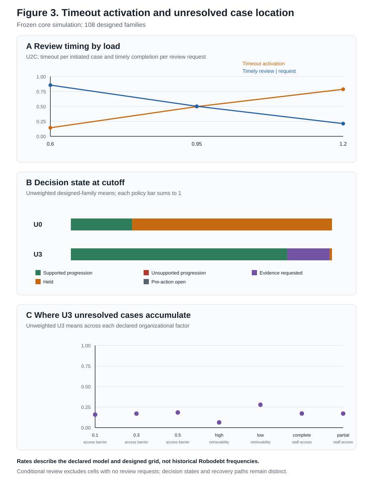

# From Incomplete Evidence to Automated Action: A Formal Model and Dynamic Simulation of Review Capacity and Timeout Rules, with a Robodebt Application

**Eli Talbert**

Independent researcher

Correspondence: etalbert102@gmail.com

## Abstract

AI-generated classifications, summaries, and recommendations can enter workflows that route cases, assign review, trigger deadlines, and permit action. The central question is: when evidence becomes less decision-relevant, what may an automated workflow now do? This article defines robust permission as an operational test: weaker evidence should not newly enable an exact action—such as debt calculation, recovery, or account provisioning—unless that action remains independently supported across every admissible refinement. The workflow must withhold progression from the automatic set pending review, the reviewer must authorize the exact action, and the executing system must revalidate support at execution. The study applies this test to the documented Robodebt process and uses a design-frozen finite-cohort simulation to estimate how often limited capacity activates declared timeout consequences. Fail-open rather than fail-closed timeout increased unsupported progression by 0.476 of initiated cases on average across 108 designed families (range 0.042–0.881). An information-first policy reduced unresolved non-progression by 0.594 relative to conservative holding while adding interaction and workload events; among the three reported average factor margins, retrievability had the largest unresolved-case difference. These are designed-scenario results, not historical Robodebt estimates or an overall policy ranking. A five-step protocol turns the definition, case mapping, and simulation into a prospective workflow test.

*Keywords:* automated decision-making, human oversight, uncertainty, discrete-event simulation, Robodebt

## 1. Introduction

### 1.1 The organizational failure mode

A defensible abstraction can still remove the distinction that would have triggered caution. A classifier may truthfully report a broad category; an agency may consistently transform an annual total into period values; a large language model summary may accurately compress its source. Yet once that representation enters an operating workflow, it can change routing, review, deadlines, and action. Emerging technologies motivate the inquiry because their outputs may move across systems and trigger downstream rules quickly. The relevant unit of governance is therefore not the model output alone, but the full chain from evidence and representation through routing, review, action, correction, and restoration.

The emerging-technology connection is functional rather than historical. Before deploying an AI-enabled workflow, an organization can vary the representation of the same output and stress the downstream gate under expected and adverse load. Robodebt contributes something the synthetic examples cannot: a documented, consequential institutional sequence from evidence transformation through automated action, recovery, and reassessment. It is a testbed for that governance architecture, not evidence about current AI prevalence or performance.

This paper calls what the operating workflow allows to proceed *functional permission*. Functional permission is distinct from formal authority, legal validity, and action actually taken. It includes every action the workflow makes automatically available in the current state, whether or not an operator selects it and whether or not formal authority has changed. The central question is: when evidence becomes less decision-relevant, what may the workflow now do automatically? The failure occurs when lost information removes a safeguard or enables progression the remaining evidence cannot independently support. In the Robodebt application, that would mean using imputed fortnightly values after nonresponse to enable debt calculation, debt notice, or recovery.

### 1.2 Why nominal review is insufficient

The presence of a review field does not answer that question. A gate may be missing, fail open, or control the wrong action. Review is effective only if the case is surfaced before automatic progression, evidence bearing on the exact action is visible, an authorized reviewer can stop or modify that action, the workflow enforces that dependency, and the decision is completed and recorded before intervention is foreclosed. The formal model calls this `ReviewEffective`. Timely supported service—reaching a supported disposition by a declared deadline—is a distinct construct, but the simulation does not estimate it. Capacity and timeout rules remain governance choices because they determine what happens when review does not finish.

### 1.3 Completed research design

The study combines five evidence layers: a formal model, a controlled representation pair, a documented Robodebt application, a dynamic simulation, and a prospective protocol. Within that architecture, F0 tests evidentiary fidelity, F1 robust permission, F2 fallback consequences, F3 operational review, F4 material surfacing, and F5 correction and restoration. Table 1 maps each layer to those diagnostics. None substitutes for another.

**Table 1**

*Evidence Architecture and Diagnostic Scope*

| Layer | Question and principal diagnostics | Evidence used | Cannot establish |
| --- | --- | --- | --- |
| Formal model | What may weaker evidence permit, and what must review or restoration satisfy? F1–F5 | Declared refinement, support, action, gate, and consequence rules | Frequency, historical causation, or welfare |
| Controlled representation pair | Can representation alone change routing and automatic permission? F0 and F4; F1 is unassessable because evidence is fixed | Same synthetic case and output; only representation changes | Prevalence, queues, or review effectiveness |
| Robodebt application | Does a documented process contain the relevant evidence-to-action structure? F0, F4, and structural F3/F5 | Fixed source packet and dated OCI profiles | Independent causation or numerical calibration |
| Dynamic simulation | How often do capacity and timeout rules activate, and with what modeled process outcomes? Paired outcomes relevant to F2 and the timing component of F3; timely supported service is unestimated | Designed families, paired policies, and finite queues | Historical rates, complete welfare, or full terminal comparison |
| Five-step protocol | Can the same questions be posed prospectively in another inspectable workflow? All diagnostics as applicable | Article procedure | Usability, field transfer, or prevalence |

### 1.4 Findings and contributions

The results separate rule-implied directions from dynamic quantities. Fail-closed gate safety and fail-open release follow the policy definitions; the simulation estimates how often finite capacity activates those consequences. Holding review machinery and paired cases fixed, fail-open timeout increased unsupported progression by 0.476 on average across the designed families. Information first preserved the permission boundary and reduced unresolved non-progression relative to conservative holding, but required more interaction and agency-workload events. Within that policy, retrievability produced a 0.215 range in the unresolved-case rate, while access barrier and staff access produced little variation. Interaction counts do not measure effort, psychological cost, or welfare, and the model does not estimate timely supported service or terminal resolution.

This paper’s claimed contribution is the joint specification and demonstration of a workflow-level permission rule: loss of decision-relevant information cannot by itself expand automatic progression unless the action remains independently supported, while capacity and timeout rules determine whether unresolved review produces holding or action.

Figure 1 previews the evidence-to-action chain that serves as the unit of analysis and the five diagnostic steps developed in Section 7.

**Figure 1**

*Evidence-to-Action Chain and Five Process-Red-Team Steps*

*Note.* The protocol follows one action through representation, permission, review, execution, and restoration while keeping formal authority, independent support, automatic permission, and executed action distinct.

## 2. Mechanism, Literature, and Research Questions

### 2.1 Representation-preservation controlled pair

A controlled pair is two deterministic traces of the same synthetic case and the same stored model output. The operational policy, routing rule, process state, reviewer resource, clock, and absence of random draws are held fixed. Only the representation transformation and the representation it mechanically emits differ. The Robodebt application instead concerns aggregate evidence transformed into imputed period values, and the simulation includes unresolved or missing period evidence. Their shared conclusion is limited to the downstream permission structure: a policy-material distinction is lost or unresolved, and a downstream rule changes permission.

The stored output contains a broad category, low confidence, and two typed alternatives, one of which is material because the fixed organizational rule makes its presence trigger scrutiny. In the preservation arm, the alternatives, confidence, unresolved status, and provenance remain visible. The material alternative triggers an information action, enhanced scrutiny, and a fail-closed review dependency; routine administrative disposition is unavailable automatically. In the fallback arm, the identical output becomes only the broad category. That category is compatible with both alternatives and is not literally false, but it suppresses the distinction used by the rule. Consuming that representation, the same rule routes the synthetic case routinely, removes the information and review steps, and makes routine disposition automatically available. The demonstrated change is in configured routing and availability; the account does not specify the exact consequential disposition or establish its execution or injury. The executable fixture and its safety-specific labels remain in the supplement so that the mechanism can be reproduced without making that domain the article's substantive frame.

Two controls bound the interpretation. When the output contains no policy-material alternative, changing representation leaves routing unchanged. When the safeguard is representation-independent, both representations retain scrutiny. Because the evidence is fixed, the pair isolates representation suppression rather than evidentiary weakening; F1 is unassessable. Frequency and review effectiveness require separate evidence.

### 2.2 Mechanism and scope

The shared permission structure requires three conditions: a representation that is defensible at some level of abstraction, or an unresolved evidence state; a distinction that matters to an independently specified policy or support rule; and a downstream rule that relaxes a safeguard when that distinction disappears. None is sufficient alone. Coarsening can be harmless when the lost distinction is immaterial, and weaker evidence can properly trigger a hold or a request for more information. In the controlled pair, the inspectable result is the rule's changed routing and automatic availability when its triggering distinction is suppressed.

The action direction matters. *Progression* advances or commits the process, imposes an external consequence, or forecloses a required safeguard. *Constraint* pauses or contains progression; *information* obtains evidence without independently releasing unsupported progression; and *restoration* repairs a prior process or consequence. The claim is that information loss should not add unsupported automatic progression, although it may justify separately evaluated constraints or information seeking. The rule preserves permission rather than guaranteeing complete safety: delay, deprivation, abandonment, queue displacement, and spillovers are not measured here as terminal consequences.

This is a base workflow vulnerability, not necessarily an attack. Workflow susceptibility means a declared mutation can reproduce it. Demonstrated exploitation requires separate evidence that the mechanism is inducible, observable, repeatable, and beneficial to an actor. Neither the controlled pair nor the Robodebt application supplies those four findings.

### 2.3 Literature and proposed integration

Three research traditions frame the unresolved workflow question. Work on information structures, robust choice, selective classification, abstention, and uncertainty communication establishes that evidence can be ordered, ambiguity can matter to choice, and uncertain outputs can be withheld or communicated (Blackwell, 1953; El-Yaniv & Wiener, 2010; Franc & Průša, 2019; Gilboa & Schmeidler, 1989; Prabhudesai et al., 2023). Uncertainty-to-action binding already makes oversight responses explicit (Anyabolu et al., 2026). Lin et al. (2026) examine failures in observable evidence-to-action chains for tool-using agents. This study instead specifies an action-set test for institutional workflows, binds it to review and timeout rules, and demonstrates it in a documented administrative process rather than evaluating agent task performance.

Research on effective human oversight, automation bias, administrative burden, automated administration, and contestability shows why nominal human presence may be insufficient. It also treats burden, discretion, and challenge mechanisms as institutional rather than interface-level problems (Alon-Barkat & Busuioc, 2023; Bennett et al., 2026; Landau et al., 2024; Moynihan et al., 2015; Roehl, 2023; Roehl & Hansen, 2024; Sterz et al., 2024; Sztandar-Sztanderska, 2026). Green (2022) argues that human-oversight policies can legitimate systems without evidence that oversight works; Hardy (2026) separates observation, interpretation, challenge, intervention, and recovery. The present study makes one narrower contribution: it tests whether review binds an exact action and what timeout does when review is incomplete, while leaving reviewer psychology outside its numerical claims.

Finally, queueing, system safety, AI risk governance, and algorithmic impact assessment treat performance as a property of service capacity, control structures, context, ownership, and feedback rather than a component in isolation (Leveson, 2012; Little, 1961; National Institute of Standards and Technology, 2023; Reisman et al., 2018). Lykouris and Weng (2025) optimize review admission and scheduling under congestion, while Wang and Rachev (2026) analyze capacity regimes. This study neither learns an admission policy nor locates an analytic phase transition. It stress-tests fixed safeguard and timeout rules, using simulation only where event timing and shared queues make the activation frequency nontrivial.

Robodebt scholarship supplies a complementary institutional account. Rinta-Kahila et al. (2022) explain how destructive effects arose, persisted, and were delegitimized; Carney (2019) analyzes the program's illegality and failed rule-of-law safeguards. The present application does not replace either causal or legal analysis. It asks a different, inspectable question: given the documented evidence transformation and action sequence, which exact actions pass the declared robust-permission test, and which later safeguards leave an upstream permission defect intact?

The paper brings these literatures together around one organizational sequence. Information ordering and robust choice supply the refinement and support structure. Selective classification and uncertainty-to-action work inform rules for withholding action or seeking evidence. Oversight, queue control, and contestability add finite capacity, action-binding review, correction, and restoration. The claimed contribution lies in that integration and demonstration, not in field-wide priority or any single component.

### 2.4 Research questions and falsifiability

The study asks: (1) when may weaker evidence support automatic progression under the proposed robust-permission rule; (2) under the tested access and capacity conditions, does a configured gate block progression with unmet prerequisites, and how does timely review completion vary; and (3) which interventions avoid unsupported progression while keeping unresolved cases, interaction, workload, and recovery-path entry visible? The remaining review conditions are held invariant or demonstrated structurally rather than estimated.

The design can fail its intended contribution. The representation account would lose diagnostic value if a valid enabling pair showed no representation-to-permission change, or if ordinary component-local checks located every induced failure. Ordinary interface or missing-input validation remains an unevaluated alternative account of the synthetic defect; the pair does not establish added diagnostic value over those checks. The dynamic account would narrow to authored semantics if access, capacity, and deadlines produced no consequential variation across the frozen range. The practical account would fail if it could not locate a transition, responsible owner, intervention, tradeoff, and replayable repair beyond what a local accuracy or calculation check already provides. These are contribution-level falsifiers, not population hypotheses.

## 3. Formal Model

In plain language, the model asks three questions. What possibilities remain compatible with the evidence? Which exact actions does the workflow make automatically available? Would each progression action still be supported if the missing detail were resolved in any admissible way? In the Robodebt mapping, the annual employer total is aggregate evidence, supported fortnight-specific income records define finer evidence states, and imputed fortnightly values are not treated as observed period evidence; debt calculation, debt notice, and recovery are the actions under inspection. If support for an action fails under any admissible refinement, the workflow must seek evidence, pause the case, or require effective review; a reviewed action must be supported again before execution. The notation below keeps formal authority, operational permission, and executed action distinct.

### 3.1 Evidence, compatible states, and refinement

An evidence state `e` denotes a set of states compatible with what is known. Evidence `e_more` refines `e_less` when its compatible set is a nonempty subset of the coarser set under independently declared source and measurement assumptions. Refinement is therefore about excluded possibilities, not confidence alone: two estimates with different confidence scores need not be comparable, and a more confident transformation can still discard a policy-relevant distinction.

The admissible refinements of `e_less`, written `Ref(e_less)`, must be specified independently of the action the workflow prefers. A pass must cover every admissible refinement. Coverage can be established by enumerating the full set, defining it symbolically, or testing a sound conservative superset. A validated counterexample can prove failure, but an unsuccessful search cannot prove a pass. If the support rule, refinement coverage, or action identity is missing, the result is `unassessable`, not a pass inferred from missing evidence.

### 3.2 Representation and evidentiary fidelity

A versioned map transforms evidence into the representation consumed downstream. Claims remain typed as observed, derived, imputed, disputed, or missing and retain their sources, assumptions, transformations, and versions. F0, *evidentiary fidelity*, asks whether claims are supported as typed, lineage is complete, evidence states remain distinguishable, and downstream rules can inspect the required provenance. F4, *material surfacing*, asks whether the meaning of every independently material distinction reaches a role that can intervene before action or expiry.

An annual total may be accurate, or the broad label `vehicle` compatible with every live alternative, while the representation loses the type, provenance, dispute, or temporal pattern needed for policy and review. A truthful aggregate can therefore pass a local consistency check yet fail the workflow-level fidelity or surfacing requirement.

### 3.3 Authority, permission, and action

Formal authority `L(q)` is the action set authorized in process state `q`: historical values require an authoritative source, while hypothetical models may declare and label them explicitly. Automatic functional permission `P_auto(e,q,t)` is the complete set that the operating workflow can execute without a new effective review or external authorization. Executed action `X(c,t)` records what actually occurred. The three sets are analytically independent: permission does not imply execution or legality, and consistent implementation does not prove independent evidentiary support.

Actions are fully instantiated by target, parameters, timing, consequence, reversibility, authority condition, and rule version. They are classified relative to a declared baseline as progression, constraint, information, or restoration. An evaluation specification independent of the workflow's preferred result supplies materiality, admissible refinements, action-support rules, comparison fields, review conditions, contestability thresholds, and restoration obligations. It may not be revised to produce a preferred workflow result. Support and permission are reevaluated after any material change in evidence, representation, time, process state, policy, or rule version. Institutional implementation requires assigning responsibility for approving and revising this specification; that assignment remains unresolved here. Specification independence does not establish substantive adequacy, reviewer correctness, or enforcement. Treating the complete workflow rather than a component as the unit of governance is a proposed principle, not a universal empirical finding.

### 3.4 Robust permission and safe fallbacks

As a proposed normative standard for automatic progression under coarser evidence, define robust permission as the intersection of progression actions independently supported under every admissible refinement:

`P_robust(e_less,q,t) = intersection of J_progress(e_more,q,t) over e_more in Ref(e_less)`.

F1 is the operational test of this standard: it passes exactly when every automatically permitted progression action under `e_less` belongs to `P_robust`. A minimal satisfying case holds the case and requests records while automatically permitting no new progression. A minimal failure occurs when an annual total automatically enables an exact action, such as a debt notice with specified target and amount derived from imputed period values, but at least one admissible period-specific refinement fails the independent support rule for that same action. Workflow consistency cannot manufacture support because the evaluation rule is separate from the permission rule.

F2 governs newly added constraint or information actions. A helpful label is insufficient: the action must be compared with an explicit hold from the same initial state, with the same cohort and exogenous inputs. The comparison must include the whole affected unit when an action consumes shared resources or changes another case’s queue, deadline, or timeout. The fallback fails if executing it releases unsupported progression for the focal case or a spillover case, or if required authorization or reversibility is absent. Thus uncertainty may expand information seeking or reversible constraint, but only after evaluating what that intervention causes; it cannot be relabeled progression.

### 3.5 Review, service, contestability, and restoration

F3 governs progression that the workflow withholds from the automatic set pending review. `GateSafe` asks whether a configured dependency prevents action while prerequisites remain unmet. In this study’s evaluative definition, `ReviewEffective` additionally requires timely surfacing, access to evidence bearing on the exact action, an authorized reviewer with stopping power, enforced dependency, completion before foreclosure, and a recorded decision. The separate service question is whether a supported disposition is reached by a declared deadline. A gate can be gate-safe while effective review and timely supported service both fail.

The reviewer’s authorization binds the exact action, case, evidence and rule versions, conditions, and expiry. The executing system must revalidate support and the authorization's applicability at execution. Notice, a reviewer label, a stale decision, post-action reassessment, or authorization of a different action instance does not satisfy F3.

Because pre-action review does not establish post-action repair, F5 separates six questions often collapsed into “appeal available”: Does a feasible correction path exist? Is it prospectively reliable under access, capacity, and timing? Was an opportunity available? Was it used? Did correction finish? Did every modeled consequence return to baseline? Correcting the recorded decision does not prove restoration of recovery status, money, access, time, or another consequence. Pending horizons are `unassessable`; after the horizon, any consequence required to return to baseline that remains unrestored prevents complete restoration.

### 3.6 Direct implications and the simulation question

Robust permission is a definition and an operational test, not a discovered theorem. Because the robust set is defined as the intersection of progression actions supported under every admissible refinement, F1 passes exactly when automatic progression under the coarser evidence is contained in that set. A single valid refinement that excludes an automatic action proves failure. A pass requires a sound coverage argument, fixed comparison state and rules, unambiguous action identity, and an independently specified support rule. These requirements make the assessment conditional on the declared specification; they do not settle whether an institution should adopt this standard rather than an alternative support standard.

The review implication is similarly direct. A non-bypassable fail-closed gate blocks progression while prerequisites remain unmet, even if review is delayed. If required work plus backlog exceeds available service over the review window, some work cannot finish in time. A fail-closed timeout retains those cases; a fail-open timeout may release them. Identical review completion can therefore produce opposite permission consequences. The simulation does not establish that direction. It estimates how often the declared timeout is reached across finite queues and how the unresolved cases are distributed.

A short capacity calculation could show that work exceeding available service must leave some requests unfinished. It would not determine which cases enter review after engagement and retrieval, when their deadlines occur, or where unresolved cases sit after assistance, review, and timeout. Those features are path-dependent and share finite resources. The simulation represents them explicitly, pairs each policy on the same cases and exogenous draws, and reports the resulting activation frequencies. Its value is therefore diagnostic rather than predictive: it identifies which authored rule is activated, how often, and at which process state cases accumulate. Full notation, subordinate properties, and counterexamples remain in the repository specification.

Those implications do not determine whether information acquisition improves operational outcomes. Information first may preserve permission while changing interactions, workload, recovery-path entry, and unresolved non-progression. These quantities depend on the declared process and parameters, so the simulation treats information first as an empirical comparison.

## 4. Robodebt as a Documented Process Application

### 4.1 Why this case

The documented OCI sequence runs from aggregate income through imputed period values, notices, automated calculation, debt action, recovery, and reassessment. This makes Robodebt structurally compatible with the proposed mechanism. Policy intent, legal interpretation, incentives, and evidentiary risk remain alternative explanations. Robodebt is a documented institutional testbed, not contemporary machine learning or generative AI.

### 4.2 Sources and application validity

The fixed packet contains ten sources retrieved through 31 October 2026. Ombudsman reports provide the principal process record (Commonwealth Ombudsman, 2017, 2019), Deloitte maps provide node-level structure (Deloitte for the Royal Commission into the Robodebt Scheme, 2023a, 2023b, 2023c), and the Royal Commission supplies attributed historical findings and recommendations (Royal Commission into the Robodebt Scheme, 2023). Services Australia (2025) supplies limited current context. The Ombudsman’s income-apportionment report is used only to distinguish that practice from Robodebt income averaging (Commonwealth Ombudsman, 2023).

The analysis distinguishes three validity questions. First, are attributed facts anchored to the proper source and period? Second, does the study reasonably map those facts onto evidence, transformation, routing, action, review, and correction constructs? The dated early and enhanced OCI profiles support both judgments, but neither establishes that the proposed mechanism independently caused the program’s outcomes. Third, numerical calibration would require historical distributions for arrivals, capacity, service, engagement, retrieval, correction, and restoration. The packet does not supply them, so the paper makes no calibration claim.

### 4.3 Early OCI process profile

The early profile covers the July 2016 OCI launch through 19 January 2017, ending before the first specifically dated letter change. Under the documented OCI design, matched Australian Taxation Office (ATO) pay-as-you-go income and Centrelink information passed through refresh, inclusion, discrepancy, and risk rules before a notice was sent through the selected digital channel or last-known address. The initial letter allowed 21 days from its date to respond, with a reminder after 14 days (Commonwealth Ombudsman, 2017, paras. 1.17–1.29; Deloitte for the Royal Commission into the Robodebt Scheme, 2023a, 2023b, 2023c).

A responding recipient could confirm or correct employer, amount, and pay-period information and supply evidence; the documented OCI design routed specified errors or unresolved inputs to compliance-officer handling. Under that design, recipients had to reconstruct and enter historical income information. The Ombudsman noted that decision accuracy depended on their ability to obtain those records despite weaker information-gathering powers and possible bank-statement costs (Commonwealth Ombudsman, 2017, paras. 3.26–3.28). If the recipient did not respond by the due date, the documented OCI design evenly apportioned ATO earnings information over the employer-reported employment period and calculated entitlement and any debt. The mapped process distinguishes computation from completion and committed debt raising, followed by debt advice: a debt notice made the resulting account payable, after which normal recovery could commence. A provisional computation alone is not automatically consequential progression. Later information could trigger reassessment, and internal review remained available (Commonwealth Ombudsman, 2017, paras. 1.17–1.29, Appendix B; Deloitte for the Royal Commission into the Robodebt Scheme, 2023c).

The critical analytical transition is not aggregation alone. An annual employer total is evidence about total income, but even apportionment creates fortnightly values through a transformation rather than revealing actual fortnightly income. In the documented OCI pathway, the nonresponse rule allowed those values to feed calculation and, where the process raised a debt, an actionable debt notice and recovery; the study maps that sequence as a coupling of representation, deadline, and permission. The mapping distinguishes provisional calculation from commitment and external consequence; legal and monetary validity of particular debts remains outside the analysis.

The documentary record fixes the 21-day clock, 14-day reminder, averaging transition, debt-notice path, recovery, and reassessment opportunity. It does not yield model-ready queue capacity, service-time, notice-engagement, evidence-retrieval, correction-uptake, or restoration-delay distributions. Those quantities remain visibly stylized in the simulation.

### 4.4 Enhanced OCI and repair mechanisms

The enhanced profile is an as-documented early-2017 repair bundle, not a single policy activated on one invented date. The Commonwealth Ombudsman’s (2017) April report identified changes beginning with the first letter revision on 20 January and further changes during February. The bundle added direct access using a confirmation code and customer reference number, clearer contact information, registered-mail and telephone follow-up, more recent address information where authorized, and 28 days from receipt with a signposted extension route.

The documented design routed disputed inputs, complex circumstances, selected other-income answers, and record-access difficulties to manual intervention. It added bank-statement entry, clearer handling when payslips were unavailable, a visible estimated gross amount, and more opportunity to revise inputs. The Ombudsman reported that bank statements were accepted when other historical-income evidence was unavailable. It separately reported the agency's statement that collector referral after nonresponse required a notice to have been received and ignored; enforcement in particular cases is not established (Commonwealth Ombudsman, 2017, paras. 1.30–1.46).

These changes did not require period-specific evidence for aggregate-only debt calculation. The sequence is structurally compatible with the proposed mechanism, but its action-specific historical F1 verdict is `unassessable`: the record lacks an exact action instance, independent support prerequisite, and defeating admissible same-total refinement. The downstream receipt-and-ignoring condition cannot supply upstream period evidence. Better access and surfacing can therefore coexist with a permission defect. Enforcement and later variants remain outside the profile.

Figure 2 contrasts the documented early OCI pathway with the enhanced repair bundle and identifies the separate simulation layer.

**Figure 2**

*Early and Enhanced OCI Process Profiles*

*Note.* Source-grounded process structure establishes analytical relevance; the simulation layer remains explicitly stylized rather than a numerical reconstruction of Robodebt. The historical process structure is synthesized from Commonwealth Ombudsman (2017, paras. 1.17–1.46, Appendix B) and Deloitte for the Royal Commission into the Robodebt Scheme (2023a, 2023b, 2023c).

### 4.5 Formal crosswalk and inference limits

The documents support the process facts; the crosswalk is the study’s analytical mapping. An annual employer-income total and broad employment period are coarser evidence; supported fortnight-specific income and working dates are admissible finer states. Even apportionment is a representation rule because it creates period values from aggregate evidence. The mapping establishes structural compatibility, not the missing action-specific historical F1 counterexample.

The documented profile identifies debt calculation, notice, recovery, hold, and evidence-request actions. Executable simulation instances become fully specified only when source bindings identify the documented process elements and separate parameter overlays supply the stylized executable values. The response deadline and nonresponse branch map to timeout semantics. The attributed enhanced receipt-and-ignoring condition maps to a gate on collector referral. Its downstream position matters: even if that gate operates as configured, it does not supply period evidence. If an upstream action fails an independently declared support rule, the referral gate cannot repair that failure; its position alone does not establish a historical F1 failure.

Notice and interface records bear on whether material information reaches a responsible officer or reviewer, but the record does not identify that actor at every transition. An officer route is a possible review path, not proof of effective review. Reassessment is a correction path. Complete restoration would additionally require every modeled consequence—including recovery status and residual downstream exposure—to return to baseline.

The historical profile supplies no action-support criterion. The study independently specifies period-specific support, materiality, action identity, review, and restoration; these cannot be attributed to the program or used to fill documentary and legal gaps. Where the record does not identify an actor or gate owner, the article attributes only the recorded state change to the OCI design.

### 4.6 Transition to simulation

Because the required historical numerical distributions are unavailable, the simulation asks a counterfactual governance question over a declared parameter space. Five counterfactual policies compare conservative holding, automatic progression, fail-closed and fail-open review, and agency-assisted information acquisition; none is a label for a historical Robodebt policy.

## 5. Dynamic Simulation Methods

### 5.1 Purpose, kernel, and unit of analysis

The simulation has a limited purpose: to measure how often finite capacity activates declared timeout consequences and to trace coupled process outcomes within the simulated system. It does not discover the logical direction of the gates. We implemented a finite-cohort discrete-event simulation of an administrative evidence-to-action process. Each run followed 80 cases under one scenario family, policy, and replication. Policies were paired within each family and replication, and the scenario family was the summary unit across designed conditions. Cases moved through engagement, evidence representation, routing, possible review, action, recovery-path entry, correction, and restoration. Staffed stages used finite-capacity, work-conserving FIFO queues with deterministic tie-breaking. At day 650, the system recorded both administratively censored work and paths lacking a modeled terminal-resolution event; neither was treated as resolved.

The kernel was case-neutral: no Robodebt identifier or case-specific rule entered its event logic. Policies, evaluation specifications, execution settings, and scenario mappings were separately controlled inputs.

Cases entered with fixed membership, latent attributes, potential evidence, and access attributes. The model retained the documented 21-day response deadline; other capacity, service, engagement, retrieval, correction, restoration, and cutoff values were stylized. Progression required period-specific evidence. The supported state had one supporting refinement; the unresolved state had supporting and non-supporting refinements, placing progression outside `P_robust`. Review could then request evidence but not authorize progression. A stored specification recorded the binary evidence universe, assumptions, exclusions, coverage argument, exact action, and conclusion basis. Routing and execution evaluated that action across every certified refinement and retained receipts linking the specification, certificate, evidence state, action, and result. These model states do not supply a historical counterexample.

Matched policies shared those case inputs and exogenous draws. Draws were keyed by case, event family, and index, so policy-induced events could not shift unrelated draws. This common-random-number design reduced computational noise without suppressing policy-induced path differences.

### 5.2 Policy designs

Table 2 compares five specified counterfactual interventions.

**Table 2**

*Counterfactual Study Policies and Principal Modeled Tradeoffs*

| Policy | Operational rule | Principal modeled tradeoff |
| --- | --- | --- |
| Claimant-led evidence and hold (U0) | Hold while required evidence is missing. | Avoids unsupported progression but may retain unresolved cases and interactions. |
| Impute and progress (U1) | Impute and permit automatic progression. | Failure benchmark for progression without action-specific support. |
| Review with fail-closed timeout (U2C) | Impute with evidence status preserved, route all potential progression to review, and hold if review does not complete in time. | Preserves the gate but can accumulate holds. |
| Review with fail-open timeout (U2O) | Impute with evidence status preserved, route all potential progression to review, and permit progression if review times out. | Converts non-completion into potentially unsupported action. |
| Agency-assisted information first (U3) | Assist engagement and retrieve evidence; progress when support is obtained and route unresolved cases to fail-closed review and holding. | Consumes resources and may add interactions, delay, or exposure. |

U2O−U2C isolated the consequence of review non-completion under otherwise shared review machinery. U3−U0 compared the bundle of assisted engagement, evidence retrieval, and unresolved-case review with conservative holding. U1−U0 was an implementation-validation contrast, not a substantive policy comparison.

### 5.3 Frozen scenario design and execution

Before inspecting core results, we froze policies, scenarios, seeds, outcomes, contrasts, and precision and analysis rules. This internal design freeze constrained result-driven tuning and supports reproduction; it was neither an external preregistration nor a basis for population inference. Freeze 4 repaired metric semantics without changing the stochastic process. The differential audit and rerun are reported in Section 5.5 and the evidence packet.

The core crossed five designed relationships, none a historical estimate. Nominal initiation load `L` was 0.60, 0.95, or 1.20; with 80 cases, two reviewers, and mean service demand `s/2`, the initiation window was `Ns/(2kL)`. Higher load therefore compressed initiation while realized review demand still depended on routing. Missing-evidence and access-barrier probabilities were each 0.10, 0.30, or 0.50. Retrieval success was 0.35 or 0.85. Partial staff access increased the uniform review-service scale from 10 to 15 days; complete access retained 10 days. Staff access changed review duration, not evidence.

Keyed `U[0,1)` draws generated binary events and stochastic timings. The model retained the documented 21-day response deadline and used a 14-day review window. Prespecified simulation settings governed notice, assistance, extensions, retrieval, recovery, correction, reassessment, restoration, and the day-650 cutoff. Recovery and reassessment used fixed service demands; review and other stochastic timings used keyed variates. Complete values are in the frozen configuration; binding receipts record which sources and declared settings supplied the executable inputs.

The 108-family design used five policies and 30 paired replications: 16,200 core runs and 1,296,000 case-policy trajectories. Load was a designed input, not measured utilization or an estimated threshold. The frozen manifest fixed 3,240 family-replication seeds per suite.

Monte Carlo standard error (MCSE) targets were 0.05 for rates and 0.06 for paired differences. A miss after 30 replications would have extended every core cell to 60; none did. A separate 16,200-run sensitivity doubled retrieval-latency scale from 10 to 20 days without pooling with the core. Because retrieval still awaited return subject only to the distant administrative cutoff, this tests delayed routing and queue phasing—not acquisition failure, abandonment, or deadline expiry.

### 5.4 Outcomes and comparisons

Every initiated case entered exactly one decision state: supported progression, unsupported progression, evidence requested after completed review, unresolved hold, or still open before action at the cutoff. Unsupported progression meant executed progression outside the robust-permission set or without required timely authorization. The primary unresolved outcome combined evidence requests, holds, and pre-action open cases so that a completed review could not be mistaken for resolution. A separate three-state partition recorded entry to the recovery path after supported progression, entry after unsupported progression, or no entry. These definitions govern findings only inside the modeled workflow.

Timely review completion used review requests—not initiated cases—as its denominator and was null when no request existed. U3 requested review only after assistance and retrieval left evidence unresolved. Completing that review did not create period evidence or authorize progression: the decision rule requested evidence and left the case in unresolved non-progression. Faster review could therefore move a case from holding to an evidence request without resolving its evidence deficit. Review completion is a queue-performance observation, not a supported disposition; timely supported service remains unestimated in this study. Gate safety was likewise conditional on an applicable gate and tested whether it blocked progression while prerequisites remained unmet.

Interaction events counted responses plus assistance requests per initiated case. They do not measure effort, subjective burden, welfare, or cost. Agency-workload events counted completed assistance, retrieval requests, completed reviews, and completed reassessments. Recovery-path entry is reported directionally because it can follow either supported or unsupported progression; it is neither error nor harm by itself. The model does not supply comparable terminal-resolution events for every policy, so terminal resolution and complete restoration are not cross-policy outcomes.

We report family-specific paired differences, 95% normal MCSE intervals, family ranges, and unweighted designed-family means. MCSE measures finite-run precision, not population, historical, or model uncertainty; cross-family means assume no real-world scenario distribution.

### 5.5 Validation, controls, and claim boundary

Freeze 4 repaired coverage, action-identity, and reporting fields without changing policies, cases, random streams, queues, or events. A differential audit paired all 32,400 Freeze 3 and Freeze 4 attempts—2,592,000 case-policy trajectories—and found identical cohorts, events, ordering, timestamps, actions, queues, and shared outcomes. Event representations differed only in configuration and attempt identities; reporting schemas, metric fields, and manifest identities also changed. The archived receipt reports unchanged process semantics. Hand traces, replay, configuration closure, adapter substitution, conservation, five negative controls, routing/execution receipts, and 209 automated checks passed. Both suites reproduced at 30 replications and all 32,400 runs reconciled without missing or unexpected identifiers. Detailed receipts remain in the reproducible package.

## 6. Results

### 6.1 How often the timeout rule activates

Under fail-closed review (U2C), timeout activation rose from 0.143 to 0.498 to 0.788 across nominal loads 0.60, 0.95, and 1.20. Timely completion conditional on a review request moved in the opposite direction: 0.857, 0.502, and 0.212. Across the full grid, 135,766 of 259,200 requested reviews completed on time, a request-weighted rate of 0.524. The mean timeout-activation rate was 0.476 across families, with a family range of 0.042–0.881 and simulation MCSE of 0.0024 for the balanced-grid mean.

The paired fail-open policy used the same cases, draws, review requests, and service process. It changed only what happened when the 14-day review deadline arrived. Fail closed retained the case; fail open permitted progression. The 0.476 timeout frequency is therefore also the mean increase in unsupported progression when fail open replaced fail closed. The simulation's contribution is the activation frequency and its variation across the grid, not the rule-implied direction.

Fail-closed review remained gate-safe in every tested family. That result does not imply timely supported service: a blocked case can remain unresolved. The three load points show how often the authored timeout activated in this design; they do not locate a continuous capacity threshold.

### 6.2 Information first changes where unresolved cases accumulate

Information first (U3) and conservative holding (U0) both produced zero unsupported progression. Their decision-state distributions differed. Under U0, 0.234 of initiated cases reached supported progression and 0.766 remained held. Under U3, 0.829 reached supported progression, 0.162 ended with an evidence request after review, and 0.009 remained held. The sole aggregate U3−U0 decision-state contrast was a 0.594 reduction in unresolved non-progression (family range 0.369–0.815; balanced-grid MCSE 0.0009).

The evidence-request state prevents a misleading interpretation of completed review. U3 generated 44,381 review requests, of which 42,098 completed on time, for a request-weighted rate of 0.949. Twenty of 3,240 family-replications generated no request and were treated as not applicable; every family had a positive request denominator after aggregation. A timely review of still-incomplete evidence did not manufacture support. It requested evidence and left the case unresolved.

Among the three reported average U3 factor margins, retrievability had the largest difference in unresolved non-progression. Mean unresolved non-progression was 0.064 under high retrievability and 0.279 under low retrievability, a range of 0.215. The access-barrier levels spanned 0.026, and complete versus partial staff access spanned 0.001. These averages compare the three displayed margins; they do not establish that retrievability uniquely explains variation across all five inputs or that effects are uniform within the grid. Under the declared decision rule, review cannot create missing period evidence, so faster completion can leave a case unresolved after an evidence request. That structural constraint does not by itself fully explain the small average service-scale margin.

The balanced crossing makes these factor margins comparable within the designed grid, but it does not turn them into field estimates or causal effects for Robodebt. Their practical use is as a red-team diagnosis. Under the declared reviewer powers and acquisition rules, the tested change in review-service scale produced little difference in average unresolved non-progression. Possible benefits for review timing or timely supported service remain separate and unestimated. The bundled U3−U0 comparison shows that assisted evidence acquisition can change the decision-state distribution while changing the work the organization and recipient must perform; it does not rank acquisition against faster review on a common resource basis.

The reduction in unresolved non-progression required additional modeled activity. Relative to U0, U3 added 1.096 interaction events per initiated case (family range 0.860–1.312) and 1.209 agency-workload events (0.749–1.728). These are event counts, not effort, psychological burden, welfare, staffing cost, or efficiency. Recovery-path entry also shifted from mostly no entry under U0 to mostly entry after supported progression under U3. That direction records process movement; it is not a harm measure or terminal resolution.

### 6.3 Sensitivity and claim boundary

Doubling the retrieval-latency scale left the substantive U3 pattern intact: the retrievability margin was 0.215, compared with 0.215 in the core, and U3 and U0 again produced zero unsupported progression. This sensitivity changes routing and queue phasing, not retrieval success, abandonment, deadline expiry, or historical calibration. Full sensitivity estimates remain in the supplement rather than adding a second set of main-text contrasts.

The simulation therefore adds two quantities that the definitions alone do not supply: how often the timeout activates across the designed grid, and how much information first changes unresolved non-progression under different retrievability conditions. It does not rank policies overall. Timely supported service, subjective burden, terminal resolution, and consequence-complete restoration remain unestimated.

Figure 3 shows the load response, the U0/U3 decision-state decomposition, and the three prespecified U3 factor margins.

**Figure 3**

*Timeout Activation and Unresolved Case Location*

*Note.* The figure reports the frozen core simulation of 108 designed families with 30 paired replications per family. Panel A uses initiated cases for timeout activation and review requests for timely completion. Panel B partitions every initiated U0 and U3 case into one decision state. Panel C reports unweighted U3 means at each declared factor level. These are designed scenarios, not historical Robodebt estimates.

Table 3 reports the nonredundant main quantities and their claim boundaries.

**Table 3**

*Nonredundant Core Simulation Quantities*

| Quantity | Estimate | Family range | Simulation MCSE | Claim boundary |
| --- | ---: | ---: | ---: | --- |
| Fail-closed timeout activation per initiated case | 0.476 | 0.042–0.881 | 0.0024 | Queue deadline misses; fail-open progression and fail-closed holding are rule-defined consequences. |
| U3−U0 unresolved non-progression | −0.594 | −0.815 to −0.369 | 0.0009 | Sole aggregate U3−U0 decision-state contrast. |
| U2C timely review conditional on request | 135,766/259,200 = 0.524 | — | — | Request-weighted diagnostic, not a supported-disposition measure. |
| U3−U0 interaction events per initiated case | +1.096 | 0.860–1.312 | 0.0018 | Event count, not effort, subjective burden, welfare, or cost. |
| U3−U0 agency-workload events per initiated case | +1.209 | 0.749–1.728 | 0.0017 | Event count, not staffing cost, efficiency, or overall value. |

*Note.* Means and ranges are unweighted across 108 designed families; each family uses 30 paired replications. MCSE measures simulation error for the balanced-grid estimate, not population, historical, or model uncertainty. A dash indicates that the diagnostic is an exact ratio of stored counts rather than a balanced-grid paired estimand.

Taken together, the formal rule identifies what must be inspected, the documented application identifies where it appears in an institutional process, and the simulation shows why review must be tested under capacity and timeout conditions. Section 7 converts those lessons into a five-step protocol.

## 7. Process-Red-Team Protocol and Governance Implications

### 7.1 What the protocol produces

Usability is a design objective, not an evaluated result. Begin with one consequential action and trace representation, routing, review, execution, contestability, and restoration. Return separate findings, missing inputs, located transitions, interventions, owners, and tradeoffs—not an overall score. Use documents for structural findings, a deterministic trace for ordered events, and simulation when conclusions depend on timing or shared resources. A controlled pair changes only the named representation, rule, or intervention. If required inputs are unavailable, return `unassessable` and name them. The five steps below are a candidate article-level procedure for inspectable workflows; an optional appendix supplies implementation fields and worksheets.

### 7.2 Step 1: map transformations and ownership

For each handoff, record the source value and type—observed, derived, imputed, disputed, or missing—the transformation, assumptions, representation, provenance, and owner. Locate the first point where a policy-relevant distinction disappears or becomes unavailable to an empowered role. F0 tests evidentiary fidelity; F4 tests material surfacing. A broad label may fail by hiding imputation, conflict, lineage, or action-relevant scope. Repairs retain typed provenance, expose disputes, bind transformations to sources, and name the responsible interface or workflow owner.

### 7.3 Step 2: test what weaker evidence permits

Inventory exact progression, constraint, information, and restoration actions. For each automatic progression, record target, parameters, prerequisites, support, default, and timeout. F1 fails when weaker evidence permits an action excluded under any valid refinement; passage requires a certificate covering the declared set. F2 compares a fallback with an explicit hold of the matched case from the same starting state, using the same cohort and exogenous inputs and including every affected case, queue, resource, and deadline. Shared-resource effects require a system-level comparison. Repairs include narrower permission, evidence acquisition, reversible constraint, effective review, or fail-closed timeout.

### 7.4 Step 3: test whether review is operational

Decompose “human review”: Is a gate configured and blocking? Does an authorized reviewer receive material evidence and control the exact action? Does the workflow wait? Is authorization current at execution? Is a supported disposition reached by the service deadline?

Report gate safety and the conditions for effective review as the component checks supporting the F3 assessment, and report timely supported service separately. A fail-closed gate may be safe while service fails; completed review may be stale, unsupported, or nonbinding. With no gate, gate safety is not applicable, although a required missing gate remains a failure. Locate defects in visibility, stopping authority, dependency, timing, execution-state revalidation, or capacity—not in the mere presence of a reviewer label.

### 7.5 Step 4: stress access, workload, and deadlines

Use the simplest adequate level: documents for timeout rules, traces for event order, queue calculations for simple capacity questions, and dynamic simulation for shared resources, feedback, or spillovers. If the question concerns a boundary rather than a sampled operating region, state how that boundary was located and with what resolution.

Stress access, evidence, arrivals, service demand, capacity, deadlines, and timeouts. Report gate safety, timely completion, unresolved cases, interaction events, workload, recovery-path entry, and restoration separately. Do not equate delay with safety, backlog reduction with resolution, recovery-path entry with harm, or interaction events with subjective burden. Recommendations must identify improvement, deterioration, and what remains unmeasured.

### 7.6 Step 5: test contestability and restoration

Separate six questions hidden by “appeal available”: Does a structural path exist? Is access reliable? Was an opportunity available? Was it used? Did correction occur? Were all required consequences restored? Documents support structural findings; realized and timely conclusions require a trace or system model with declared horizons.

Declare the consequence vector and baseline before claiming restoration. Correcting a decision may restore some consequences, but correction alone does not establish complete restoration of recovery status, time, access, or other consequences. Pending horizons are unassessable, not failed. Repairs may pause recovery, acquire evidence, reserve reassessment capacity, extend windows, and separate correction from restoration ownership. Keep costs and delays visible and name every omitted consequence.

### 7.7 Fixed Robodebt worked example

The worked pair is a nonhistorical illustration. It locates the annual-total-to-fortnightly transformation; names debt calculation, notice, and recovery as actions under inspection; asks whether officer handling sees material evidence and binds those actions; assumes a notice that does not arrive before the 21-day deadline; and separates reassessment from restoration. The case, evidence, process, resources, rules, and draws remain fixed. Only the policy changes: impute and progress versus information first.

After the assumed notice failure and deadline expiry, impute and progress permits action on imputed period values; information first holds while seeking evidence. Recovery and restoration remain unresolved. Establishing them would require the acquired records and disposition, recovery rule, correction timing, restoration dependencies, consequence baseline, and observation rule. Evidence acquisition alone cannot establish avoided recovery because supported progression can also enter that path. The supplementary trace scripts rather than independently derives these endpoints. The illustration does not show that information first is costless, generally superior, or historically typical.

The comparison matters conceptually because a local check might confirm that averaging ran as specified; another might confirm that notice issued. Neither check alone establishes how failed access, imputation, deadline expiry, and the permission rule combine, and the illustration does not demonstrate the unresolved endpoints.

An optional technical appendix provides implementation fields, evidence limits, and tradeoffs. Its scripted recovery and restoration events do not establish those outcomes here.

### 7.8 Governance interventions and transfer limits

Four intervention responsibilities follow; assigning an owner does not establish effectiveness.

**Representation and interface owners:** preserve evidence state, provenance, and disputes. The pair demonstrates a configured routing and availability difference; added interface complexity is unmeasured.

**Information-service and policy owners:** acquisition with holding is model-demonstrated. U3 increased interaction and agency-workload events, but the bundle does not identify each component's contribution. Access and deadline changes remain untested proposals.

**Gate and operational owners:** fail-closed timeout behavior is model-demonstrated. Reserved staff capacity, metered arrivals, and priority scheduling are unvalidated design proposals; their tradeoffs may include resource consumption, queue displacement, and unresolved holding.

**Recovery and restoration owners:** the enhanced profile reports a collector-referral condition without establishing enforcement. Pausing action during contest and repairing later consequences remain untested proposals; preventing recovery entry would not demonstrate restoration after recovery.

Applied prospectively, this candidate procedure can examine a current AI deployment before rollout or a material workflow change: run matched representations of the same output—with and without provenance, alternatives, disputes, or temporal detail—through the actual downstream rules, then stress the resulting gate under expected and adverse load. This is an ex ante governance use, not evidence that contemporary deployments reproduce Robodebt.

## 8. Limitations and Conclusion

### 8.1 Limitations

The formal results are conditional on the proposed standard and declared specification. Robust permission depends on admissible refinements, an independent support rule, exact action identities, and action ordering. Independence does not establish an adequate specification, correct reviewers, or enforcement. Missing inputs yield `unassessable`, not an inferred pass. New domains require their own specification and coverage argument; ownership and the choice among support standards remain unresolved.

Likewise, the Robodebt application establishes documented structural relevance and compatibility with the proposed mechanism, not independent causation or numerical calibration. The selected sources, dates, and recorded precision limit the early and enhanced OCI profiles. Executable queue, engagement, retrieval, service, correction, and restoration values are stylized. Simulation rates therefore do not estimate historical Robodebt prevalence, capacity, delay, debt error, or causal effects. Historical quantification would require a separately sourced dataset, new measurement model, and new design freeze. The study supplies no monetary-entitlement oracle and makes no independent legal judgment.

The simulation has four measurement limits. First, timely review completion is conditional on a request and does not establish a supported disposition; timely supported service is unestimated. Second, interaction events record responses and assistance requests, not evidence-production effort, psychological cost, welfare, or subjective burden. Third, not every policy has a modeled terminal-resolution event. The decision-state and recovery-entry outcomes remain interpretable, but terminal resolution and complete restoration are not comparable across all policies. Fourth, MCSE measures finite-run precision only, while unweighted cross-family means imply no real-world scenario distribution.

Beyond measurement, the kernel represents declared rules, finite queues, deadlines, keyed exogenous variation, and modeled correction paths. It does not model reviewer psychology, discretion, deference to automated outputs, strategic adaptation, endogenous demand, adaptive staffing, priority rules, or organizational learning. Nor does it supply a single welfare measure. Gate safety, timeliness, unresolved non-progression, interaction events, agency workload, recovery-path entry, correction, and restoration remain separate outcomes. Because no welfare function combines them, the model cannot rank policies overall. Delay, deprivation, abandonment, queue displacement, and spillovers were not measured as terminal consequences. Consequence-complete comparison requires future evidence, including broader sensitivities or observed institutional traces.

Finally, the study provides an illustrative Robodebt worked application whose recovery and restoration endpoints remain unresolved, and no practitioner study, usability validation, adoption evidence, or estimate of inter-rater agreement. The prospective AI application is therefore a candidate diagnostic, not evidence of field transfer or prevalence. Workflow susceptibility also does not prove demonstrated exploitation: inducibility, observability, repeatability, and actor benefit were not established.

### 8.2 Conclusion

The central question is what the workflow may newly do when a policy-material distinction is suppressed in representation, when period values are imputed from aggregate evidence, or when period evidence remains unavailable. Under the declared refinement and support rules, weaker evidence cannot justify automatic progression unless the action remains independently supported across the admissible refinements. It may permit separately evaluated constraint, information-acquisition, or restoration actions without expanding automatic progression. This identifies functional permission and operational control in the evidence-to-action process; it does not locate legal or formal authority.

Because it holds evidence fixed, the deterministic representation pair isolates a configured routing and automatic-availability change rather than evidentiary refinement or executed harm. The Robodebt application documents a different sequence, from aggregate income to imputed period values and action after nonresponse. That sequence is structurally compatible with the proposed mechanism, but its action-specific historical F1 verdict remains unassessable without an exact action instance, an independent support prerequisite, and a defeating admissible same-total refinement. A later receipt-and-ignoring guard cannot itself supply period evidence; if an upstream action fails the support test, that downstream guard does not repair the failure.

The simulation then supplies the quantities that the formal rule and documents cannot. Across the grid, fail-closed review reached timeout for 0.476 of initiated cases on average; fail open converted those same misses into unsupported progression. Information first reduced unresolved non-progression by 0.594 relative to conservative holding; among the three reported average factor margins, retrievability spanned 0.215, access barrier 0.026, and staff access 0.001. It also added interaction and agency-workload events. A completed review of unresolved evidence remained an evidence request rather than an authorization, demonstrating why queue completion and supported disposition must be kept separate.

The study supports no single policy ranking. As a proposed governance principle, control depends on whether uncertainty remains visible, whether the gate binds the exact action, whether an empowered reviewer can act before timeout, what follows non-completion, and whether correction restores every modeled consequence. Within the demonstrated model and its declared support specification, fail-closed and information-first handling preserve the robust-permission boundary. That conditional result does not establish the adequacy of every institutional specification or its enforcement. Unestimated service and terminal outcomes preclude an overall safety comparison.

For organizations considering AI-generated classifications, recommendations, summaries, or agent actions, the conditional diagnostic implication is: testing model output is not enough. Organizations must also test what downstream systems permit when provenance, alternatives, disputes, or temporal detail disappear, and whether human control remains action-binding under actual workload and deadlines. The Robodebt application shows how that diagnostic maps onto a documented automated process.

For process red teaming of inspectable workflows, the candidate diagnostic is compact: when evidence becomes weaker, what may the system now do; who can still stop it; and can they do so before the result becomes difficult to reverse? Answering those questions requires tracing evidence through representation, permission, capacity, action, and restoration. Treating that full chain—not the presence of a reviewer or the local correctness of one component—as the unit of governance is the article’s proposed principle.

## Data and Code Availability

Code and data are staged at https://github.com/etalbert102/uncertainty_permission_simulation but were not publicly accessible on 20 November 2026; activation and a logged-out check remain required. Scripted recovery and restoration events do not establish application outcomes.

## References

Alon-Barkat, S., & Busuioc, M. (2023). Human–AI interactions in public sector decision making: “Automation bias” and “selective adherence” to algorithmic advice. *Journal of Public Administration Research and Theory, 33*(1), 153–169. https://doi.org/10.1093/jopart/muac007

Anyabolu, C., Dubey, A., & Hattab, G. (2026). Visualizing uncertainty-to-action composition for human oversight. arXiv. https://arxiv.org/abs/2608.16428

Bennett, H., Currie, M., & Podoletz, L. (2026). Universal Credit: Administrative burdens of automated welfare. *Journal of Social Policy, 55*(1), 24–42. https://doi.org/10.1017/S0047279424000175

Blackwell, D. (1953). Equivalent comparisons of experiments. *Annals of Mathematical Statistics, 24*(2), 265–272. https://doi.org/10.1214/aoms/1177729032

Carney, T. (2019). Robo-debt illegality: The seven veils of failed guarantees of the rule of law? *Alternative Law Journal, 44*(1), 4–10. https://doi.org/10.1177/1037969X18815913

Commonwealth Ombudsman. (2017). *Centrelink’s automated debt raising and recovery system*. https://www.ombudsman.gov.au/__data/assets/pdf_file/0022/43528/Report-Centrelinks-automated-debt-raising-and-recovery-system-April-2017.pdf

Commonwealth Ombudsman. (2019). *Centrelink’s automated debt raising and recovery system—Implementation report*. https://www.ombudsman.gov.au/__data/assets/pdf_file/0027/286551/Centrelinks-Automated-Debt-Raising-and-Recovery-System.pdf

Commonwealth Ombudsman. (2023). *Lessons in lawfulness: Own motion investigation into Services Australia’s and the Department of Social Services’ response to the question of the lawfulness of income apportionment before 7 December 2020*. https://www.ombudsman.gov.au/__data/assets/pdf_file/0040/299947/Income-Apportionment-Lawfulness.pdf

Deloitte for the Royal Commission into the Robodebt Scheme. (2023a). *2B. Identity matching—OCI and EIC*. https://robodebt.royalcommission.gov.au/system/files/2023-03/2B-Identity-Matching-Process-Map-OCI-and-EIC.pdf

Deloitte for the Royal Commission into the Robodebt Scheme. (2023b). *3B. Income matching—OCI*. https://robodebt.royalcommission.gov.au/system/files/2023-03/3B-Income-Matching-Process-Map-OCI.pdf

Deloitte for the Royal Commission into the Robodebt Scheme. (2023c). *4B. Debt calculation and notification—OCI baseline*. https://robodebt.royalcommission.gov.au/system/files/2023-03/4B-Debt-Calculation-and-Notification-Process-Map-OCI.pdf

Deng, J. (2026). When can fraud operations authorize automation? A decision-support framework for fresh audit evidence and review workload. arXiv. https://arxiv.org/abs/2608.08577

El-Yaniv, R., & Wiener, Y. (2010). On the foundations of noise-free selective classification. *Journal of Machine Learning Research, 11*, 1605–1641. https://jmlr.org/papers/v11/el-yaniv10a.html

Franc, V., & Průša, D. (2019). On discriminative learning of prediction uncertainty. In K. Chaudhuri & R. Salakhutdinov (Eds.), *Proceedings of the 36th International Conference on Machine Learning* (Vol. 97, pp. 1963–1971). PMLR. https://proceedings.mlr.press/v97/franc19a.html

Gilboa, I., & Schmeidler, D. (1989). Maxmin expected utility with non-unique prior. *Journal of Mathematical Economics, 18*(2), 141–153. https://doi.org/10.1016/0304-4068(89)90018-9

Green, B. (2022). The flaws of policies requiring human oversight of government algorithms. *Computer Law & Security Review, 45*, Article 105681. https://doi.org/10.1016/j.clsr.2022.105681

Hardy, K. (2026). From human oversight to effective control: A comparative documentary framework for high-impact AI systems. *Design+*. Advance online publication. https://doi.org/10.36922/DP026290034

Landau, S., Dempsey, J. X., Kamar, E., & Bellovin, S. M. (2024). *Recommendations for government development and use of advanced automated systems to make decisions about individuals*. Stanford Center for International Security and Cooperation. https://cisac.fsi.stanford.edu/publication/recommendations-government-development-and-use-advanced-automated-systems-make

Leveson, N. (2012). *Engineering a safer world: Systems thinking applied to safety*. MIT Press.

Liao, J., Huang, Q., Qian, R., Mao, X., Cheng, J., Cui, K., Li, Y., Sun, J., & Hou, Y. (2026). Auditing provenance sensitivity in LLM agent action selection. arXiv. https://arxiv.org/abs/2607.20827

Lin, H., Cao, S., Luo, Z., Chai, W., Lee, M.-L., & Hsu, W. (2026). From evidence to action: How tool-using agents fail. arXiv. https://arxiv.org/abs/2610.07753

Little, J. D. C. (1961). A proof for the queuing formula: L = λW. *Operations Research, 9*(3), 383–387. https://doi.org/10.1287/opre.9.3.383

Lykouris, T., & Weng, W. (2025). Learning to defer in congested systems: The AI-human interplay. arXiv. https://arxiv.org/abs/2402.12237

Montanari, G., Scarsini, M., & Perchet, V. (2026). Learning when to automate: Queue control in human-AI service systems. arXiv. https://arxiv.org/abs/2607.06017

Moynihan, D. P., Herd, P., & Harvey, H. (2015). Administrative burden: Learning, psychological, and compliance costs in citizen–state interactions. *Journal of Public Administration Research and Theory, 25*(1), 43–69. https://doi.org/10.1093/jopart/muu009

National Institute of Standards and Technology. (2023). *Artificial intelligence risk management framework (AI RMF 1.0)*. https://doi.org/10.6028/NIST.AI.100-1

Prabhudesai, S., Yang, L., Asthana, S., Huan, X., Liao, Q. V., & Banovic, N. (2023). Understanding uncertainty: How lay decision-makers perceive and interpret uncertainty in human-AI decision making. In *Proceedings of the 28th International Conference on Intelligent User Interfaces* (pp. 379–396). Association for Computing Machinery. https://doi.org/10.1145/3581641.3584033

Reisman, D., Schultz, J., Crawford, K., & Whittaker, M. (2018). *Algorithmic impact assessments: A practical framework for public agency accountability*. AI Now Institute. https://ainowinstitute.org/publication/algorithmic-impact-assessments-report-2

Rinta-Kahila, T., Someh, I., Gillespie, N., Indulska, M., & Gregor, S. (2022). Algorithmic decision-making and system destructiveness: A case of automatic debt recovery. *European Journal of Information Systems, 31*(3), 313–338. https://doi.org/10.1080/0960085X.2021.1960905

Roehl, U. B. U. (2023). Automated decision-making and good administration: Views from inside the government machinery. *Government Information Quarterly, 40*(4), Article 101864. https://doi.org/10.1016/j.giq.2023.101864

Roehl, U. B. U., & Hansen, M. B. (2024). Automated, administrative decision-making and good governance: Synergies, trade-offs, and limits. *Public Administration Review, 84*(6), 1184–1199. https://doi.org/10.1111/puar.13799

Royal Commission into the Robodebt Scheme. (2023). *Report of the Royal Commission into the Robodebt Scheme*. https://robodebt.royalcommission.gov.au/publications/report

Services Australia. (2025). *Automation and artificial intelligence strategy 2025–27*. https://www.servicesaustralia.gov.au/sites/default/files/2025-05/automation-and-ai-strategy-2025-27.pdf

Sterz, S., Baum, K., Biewer, S., Hermanns, H., Lauber-Rönsberg, A., Meinel, P., & Langer, M. (2024). On the quest for effectiveness in human oversight: Interdisciplinary perspectives. In *Proceedings of the 2024 ACM Conference on Fairness, Accountability, and Transparency* (pp. 2495–2507). Association for Computing Machinery. https://doi.org/10.1145/3630106.3659051

Sztandar-Sztanderska, K. (2026). How context matters: Human oversight of automated decision-making systems in welfare administration. *Journal of European Social Policy, 36*(3), 255–269. https://doi.org/10.1177/09589287251358069

Wang, Z., & Rachev, S. T. (2026). Operating imperfect AI: Reliability drift and human congestion. arXiv. https://arxiv.org/abs/2601.22295
