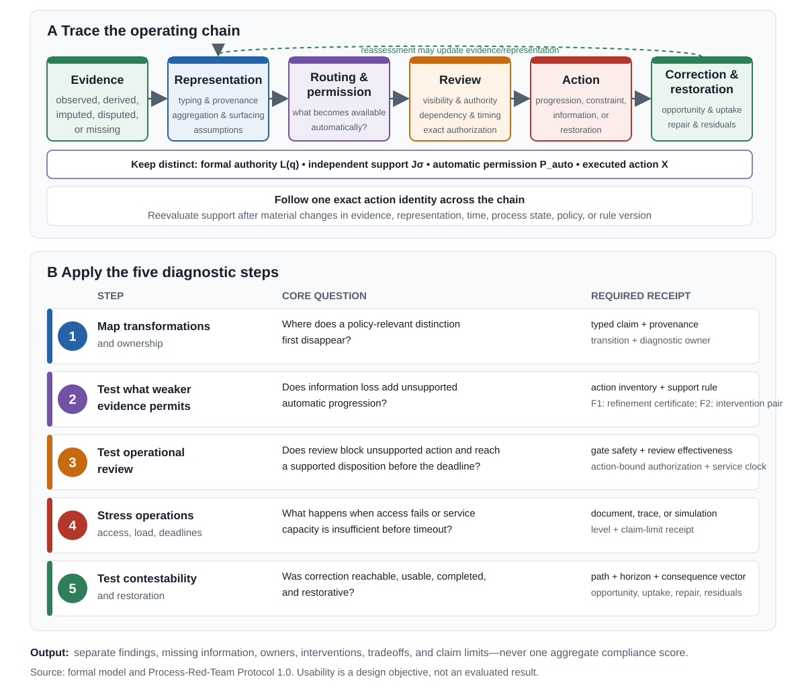

# From Incomplete Evidence to Automated Action: A Formal Model and Dynamic Simulation of Review Capacity and Timeout Rules, with a Robodebt Application

**Eli Talbert**

Independent researcher

Correspondence: etalbert102@gmail.com

## Abstract

AI-generated classifications, summaries, and recommendations can route cases, assign review, trigger deadlines, and permit action. The central question is: when evidence becomes less decision-relevant, what may an automated workflow now do? This article defines robust permission as an operational test: weaker evidence should not newly enable an exact action unless that action remains independently supported across every admissible refinement. Progression awaiting review must be withheld from automatic action; the reviewer must authorize the exact action, and the executing system must revalidate support at execution. The study applies this test to the documented Robodebt process and uses a design-frozen finite-cohort simulation to estimate how often limited capacity activates timeout consequences. Across 108 designed families, the review queue missed its 14-day window in 0.042–0.881 of initiated cases; the mean was 0.476, and fail open turned every miss into progression. Of initiated cases, 0.105 progressed with sufficient evidence but without timely authorization and 0.372 lacked both evidence and authorization. Information-first handling reduced unresolved non-progression by 0.594 relative to conservative holding while adding interaction and workload events. These are designed-scenario results, not historical estimates or an overall policy ranking. A five-step protocol turns the model, case mapping, and simulation into a prospective workflow test.

*Keywords:* automated decision-making, human oversight, uncertainty, discrete-event simulation, Robodebt

## 1. Introduction

### 1.1 The organizational failure mode

A defensible abstraction can still remove the distinction that would have triggered caution. A classifier may truthfully report a broad category; an agency may consistently transform an annual total into period values; a large language model summary may accurately compress its source. Once that representation enters a workflow, however, it can change routing, review, deadlines, and action. The relevant unit of governance is therefore the full chain from evidence and representation through routing, review, action, correction, and restoration.

The emerging-technology connection is functional rather than historical. Before deploying an AI-enabled workflow, an organization can vary the representation of the same output and stress the downstream gate under expected and adverse load. Robodebt supplies a documented institutional sequence from evidence transformation through automated action, recovery, and reassessment—a testbed for that architecture rather than evidence about current AI performance.

This paper calls the actions an operating workflow makes automatically available *functional permission*. It is distinct from formal authority, legal validity, and execution. The failure occurs when lost information removes a safeguard or enables progression the remaining evidence cannot independently support. In the Robodebt application, the actions under inspection are debt calculation, debt notice, and recovery enabled by imputed fortnightly values after nonresponse.

### 1.2 Why nominal review is insufficient

The presence of a review field does not answer that question. A gate may be missing, fail open, or control the wrong action. Review is effective only if the case is surfaced before automatic progression, evidence bearing on the exact action is visible, an authorized reviewer can stop or modify that action, the workflow enforces that dependency, and the decision is completed and recorded before intervention is foreclosed. The formal model calls this `ReviewEffective`. Timely supported service—reaching a supported disposition by a declared deadline—is a distinct construct, but the simulation does not estimate it. Capacity and timeout rules remain governance choices because they determine what happens when review does not finish.

### 1.3 Study design and contribution

The study combines a formal model, a controlled representation pair, a documented Robodebt application, a dynamic simulation, and a prospective protocol. Table 1 maps each layer to the relevant diagnostics; no layer substitutes for another.

**Table 1**

*Evidence Architecture and Diagnostic Scope*

| Layer | Question and principal diagnostics | Evidence used | Cannot establish |
| --- | --- | --- | --- |
| Formal model | What may weaker evidence permit, and what must review or restoration satisfy? F1–F5 | Declared refinement, support, action, gate, and consequence rules | Frequency, historical causation, or welfare |
| Controlled representation pair | Can representation alone change routing and automatic permission? F0 and F4; F1 is unassessable because evidence is fixed | Same synthetic case and output; only representation changes | Prevalence, queues, or review effectiveness |
| Robodebt application | Does a documented process contain the relevant evidence-to-action structure? F0, F4, and structural F3/F5 | Fixed source packet and dated OCI profiles | Independent causation or numerical calibration |
| Dynamic simulation | How often do capacity and timeout rules activate, and with what modeled process outcomes? Paired outcomes relevant to F2 and the timing component of F3; timely supported service is unestimated | Designed families, paired policies, and finite queues | Historical rates, complete welfare, or full terminal comparison |
| Five-step protocol | Can the same questions be posed prospectively in another inspectable workflow? All diagnostics as applicable | Article procedure | Usability, field transfer, or prevalence |

Figure 1 previews the evidence-to-action chain that serves as the unit of analysis and the five diagnostic steps developed in Section 7.

**Figure 1**

*Evidence-to-Action Chain and Five Process-Red-Team Steps*

*Note.* The protocol follows one action through representation, permission, review, execution, and restoration while keeping formal authority, independent support, automatic permission, and executed action distinct.

### 1.4 Findings and contributions

The results separate rule-implied directions from dynamic quantities. Fail-closed holding and fail-open release follow the policy definitions; the simulation estimates how often finite capacity activates them. Fail open converted an average 0.476 queue misses into progression: 0.105 of initiated cases lacked timely authorization alone and 0.372 lacked both evidence and authorization. Information first preserved the permission boundary and reduced unresolved non-progression while adding interaction and agency-workload events. Its sequential accounting shows where cases obtained support and where they remained unresolved; it does not isolate the contribution of each component.

This paper’s claimed contribution is the joint specification and demonstration of a workflow-level permission rule: loss of decision-relevant information cannot by itself expand automatic progression unless the action remains independently supported, while capacity and timeout rules determine whether unresolved review produces holding or action.

## 2. Mechanism, Literature, and Research Questions

### 2.1 Representation-preservation controlled pair

A controlled pair traces the same synthetic case and stored model output while holding policy, routing rule, process state, reviewer resource, clock, and random draws fixed. Only the representation changes. Robodebt instead concerns aggregate evidence transformed into imputed period values, while the simulation includes unresolved or missing period evidence. All three examine the same downstream structure: a material distinction is lost or unresolved, and a rule changes permission.

The stored output contains a broad category, low confidence, and two typed alternatives, one material to a fixed scrutiny rule. The preservation arm retains the alternatives, confidence, unresolved status, and provenance, triggering information gathering and fail-closed review. The fallback emits only the broad category. Although compatible with both alternatives, it suppresses the distinction used by the rule; the same rule then removes the information and review steps and makes routine disposition automatically available. The pair demonstrates changed routing and availability, not execution or injury. Its executable, safety-specific fixture remains in the supplement.

Two controls bound the interpretation. When the output contains no policy-material alternative, changing representation leaves routing unchanged. When the safeguard is representation-independent, both representations retain scrutiny. Because the evidence is fixed, the pair isolates representation suppression rather than evidentiary weakening; F1 is unassessable. Frequency and review effectiveness require separate evidence.

### 2.2 Mechanism and scope

The mechanism requires a defensible abstraction or unresolved evidence state, a distinction material to an independently specified rule, and a downstream safeguard that relaxes when the distinction disappears. Coarsening is harmless when the lost distinction is immaterial; weaker evidence may properly trigger a hold or information request. In the controlled pair, suppressing the trigger changes routing and automatic availability.

The action direction matters. *Progression* advances or commits the process, imposes an external consequence, or forecloses a safeguard. *Constraint* contains progression; *information* obtains evidence; and *restoration* repairs a prior process or consequence. Information loss should not add unsupported automatic progression, although it may justify separately evaluated constraints or information seeking.

This is a base workflow vulnerability, not necessarily an attack. Workflow susceptibility means a declared mutation can reproduce it. Demonstrated exploitation requires separate evidence that the mechanism is inducible, observable, repeatable, and beneficial to an actor. Neither the controlled pair nor the Robodebt application supplies those four findings.

### 2.3 Literature and proposed integration

Work on information structures, robust choice, selective classification, abstention, and uncertainty communication establishes that evidence can be ordered, ambiguity can affect choice, and uncertain outputs can be withheld or communicated (Blackwell, 1953; El-Yaniv & Wiener, 2010; Franc & Průša, 2019; Gilboa & Schmeidler, 1989; Prabhudesai et al., 2023). Uncertainty-to-action binding already makes oversight responses explicit (Anyabolu et al., 2026), while Lin et al. (2026) examine evidence-to-action failures in tool-using agents. This study instead specifies an institutional action-set test and binds it to review and timeout rules in a documented administrative process.

Research on human oversight, automation bias, administrative burden, automated administration, and contestability treats review and challenge as institutional rather than merely interface-level problems (Alon-Barkat & Busuioc, 2023; Bennett et al., 2026; Landau et al., 2024; Moynihan et al., 2015; Roehl, 2023; Roehl & Hansen, 2024; Sterz et al., 2024; Sztandar-Sztanderska, 2026). Green (2022) questions oversight mandates unsupported by evidence of effectiveness; Hardy (2026) separates observation, interpretation, challenge, intervention, and recovery. Here, the narrower question is whether review binds an exact action and what timeout does when review remains incomplete.

Queueing, system safety, AI risk governance, and algorithmic impact assessment locate performance in capacity, control structures, context, ownership, and feedback (Leveson, 2012; Little, 1961; National Institute of Standards and Technology, 2023; Reisman et al., 2018). Lykouris and Weng (2025) optimize review admission and scheduling under congestion; Wang and Rachev (2026) analyze capacity regimes. This study instead stress-tests fixed safeguard and timeout rules where event timing and shared queues make activation frequencies path-dependent.

Robodebt scholarship supplies a complementary institutional account. Rinta-Kahila et al. (2022) explain how destructive effects arose and persisted; Carney (2019) analyzes illegality and failed rule-of-law safeguards. This application asks a different question: which exact actions pass the declared robust-permission test, and which later safeguards leave an upstream permission defect intact?

The integration joins refinement and support, rules for withholding action or seeking evidence, finite-capacity review, and post-action correction in one organizational sequence.

### 2.4 Research questions and falsifiability

The study asks: (1) when may weaker evidence support automatic progression under the proposed robust-permission rule; (2) under the tested access and capacity conditions, does a configured gate block progression with unmet prerequisites, and how does timely review completion vary; and (3) which interventions avoid unsupported progression while keeping unresolved cases, interaction, workload, and recovery-path entry visible? The remaining review conditions are held invariant or demonstrated structurally rather than estimated.

The contribution would narrow if a valid representation pair produced no permission change, if ordinary component checks located every induced failure, or if access, capacity, and deadlines produced no consequential variation. The protocol would add little if it could not identify a transition, owner, intervention, tradeoff, and replayable repair beyond a local accuracy or calculation check.

## 3. Formal Model

The model asks what possibilities remain compatible with the evidence, which exact actions the workflow makes automatically available, and whether each progression action survives every admissible resolution of missing detail. In the Robodebt mapping, annual employer income is aggregate evidence, supported fortnightly records define finer states, and imputed values are not observed period evidence. If an action fails under any admissible refinement, the workflow must seek evidence, hold, or require effective review; reviewed action is rechecked before execution.

### 3.1 Evidence, compatible states, and refinement

An evidence state `e` denotes a set of states compatible with what is known. Evidence `e_more` refines `e_less` when its compatible set is a nonempty subset of the coarser set under independently declared source and measurement assumptions. Refinement is therefore about excluded possibilities, not confidence alone: two estimates with different confidence scores need not be comparable, and a more confident transformation can still discard a policy-relevant distinction.

The admissible refinements of `e_less`, written `Ref(e_less)`, must be specified independently of the action the workflow prefers. A pass must cover every admissible refinement. Coverage can be established by enumerating the full set, defining it symbolically, or testing a sound conservative superset. A validated counterexample can prove failure, but an unsuccessful search cannot prove a pass. If the support rule, refinement coverage, or action identity is missing, the result is `unassessable`, not a pass inferred from missing evidence.

### 3.2 Representation and evidentiary fidelity

A versioned map transforms evidence into the representation consumed downstream. Claims remain typed as observed, derived, imputed, disputed, or missing and retain their sources, assumptions, transformations, and versions. F0, *evidentiary fidelity*, asks whether claims are supported as typed, lineage is complete, evidence states remain distinguishable, and downstream rules can inspect the required provenance. F4, *material surfacing*, asks whether the meaning of every independently material distinction reaches a role that can intervene before action or expiry.

An annual total or broad category may be accurate while losing the type, provenance, dispute, or temporal pattern needed for policy and review. A truthful aggregate can therefore pass a local consistency check yet fail the workflow-level fidelity or surfacing requirement.

### 3.3 Authority, permission, and action

Formal authority `L(q)` is the action set authorized in process state `q`: historical values require an authoritative source, while hypothetical models may declare and label them explicitly. Automatic functional permission `P_auto(e,q,t)` is the complete set that the operating workflow can execute without a new effective review or external authorization. Executed action `X(c,t)` records what actually occurred. The three sets are analytically independent: permission does not imply execution or legality, and consistent implementation does not prove independent evidentiary support.

Actions are instantiated by target, parameters, timing, consequence, reversibility, authority condition, and rule version, then classified as progression, constraint, information, or restoration. An evaluation specification independent of the preferred result supplies materiality, refinements, support rules, comparison fields, review conditions, and restoration obligations. Support and permission are reevaluated after material changes in evidence, representation, time, state, policy, or rule version. Institutions must assign responsibility for this specification; independence alone does not ensure its adequacy or enforcement.

### 3.4 Robust permission and safe fallbacks

As a proposed normative standard for automatic progression under coarser evidence, define robust permission as the intersection of progression actions independently supported under every admissible refinement:

`P_robust(e_less,q,t) = intersection of J_progress(e_more,q,t) over e_more in Ref(e_less)`.

F1 is the operational test of this standard: it passes exactly when every automatically permitted progression action under `e_less` belongs to `P_robust`. A minimal satisfying case holds the case and requests records while automatically permitting no new progression. A minimal failure occurs when an annual total automatically enables an exact action, such as a debt notice with specified target and amount derived from imputed period values, but at least one admissible period-specific refinement fails the independent support rule for that same action. Workflow consistency cannot manufacture support because the evaluation rule is separate from the permission rule.

F2 compares a new constraint or information action with an explicit hold from the same initial state, cohort, and exogenous inputs. If the action consumes shared resources or changes another case’s queue, deadline, or timeout, the comparison includes the affected system. A fallback fails if it releases unsupported progression, lacks required authorization, or is not reversibly constrained.

### 3.5 Review, service, contestability, and restoration

F3 governs progression that the workflow withholds from the automatic set pending review. `GateSafe` asks whether a configured dependency prevents action while prerequisites remain unmet. In this study’s evaluative definition, `ReviewEffective` additionally requires timely surfacing, access to evidence bearing on the exact action, an authorized reviewer with stopping power, enforced dependency, completion before foreclosure, and a recorded decision. The separate service question is whether a supported disposition is reached by a declared deadline. A gate can be gate-safe while effective review and timely supported service both fail.

The reviewer’s authorization binds the exact action, case, evidence and rule versions, conditions, and expiry. The executing system must revalidate support and the authorization's applicability at execution. Notice, a reviewer label, a stale decision, post-action reassessment, or authorization of a different action instance does not satisfy F3.

Because pre-action review does not establish post-action repair, F5 separates six questions often collapsed into “appeal available”: Does a feasible correction path exist? Is it prospectively reliable under access, capacity, and timing? Was an opportunity available? Was it used? Did correction finish? Did every modeled consequence return to baseline? Correcting the recorded decision does not prove restoration of recovery status, money, access, time, or another consequence. Pending horizons are `unassessable`; after the horizon, any consequence required to return to baseline that remains unrestored prevents complete restoration.

### 3.6 Direct implications and the simulation question

Robust permission is a definition and operational test, not a discovered theorem. F1 passes when automatic progression under coarser evidence is contained in the robust set; one valid excluding refinement proves failure. A pass requires sound coverage, fixed comparison rules, unambiguous action identity, and an independently specified support rule. Whether an institution should adopt that standard is a separate question.

The review implication is direct: a fail-closed gate retains unfinished cases, while a fail-open timeout may release them. A static benchmark makes the analytical limit clear. Over a common horizon, if backlog plus arriving review demand is `D` workload units and available service is `C`, then at least `max(0,D−C)` units cannot finish. That bound establishes overload, but not which cases enter review after engagement and retrieval, when their individual deadlines occur, or where they accumulate afterward. The simulation adds those paths, pairs policies on the same cases and draws, and estimates activation frequencies and end states. It is diagnostic rather than predictive.

Those implications do not determine whether information acquisition improves operational outcomes. Information first may preserve permission while changing interactions, workload, recovery-path entry, and unresolved non-progression. These quantities depend on the declared process and parameters, so the simulation treats information first as an empirical comparison.

## 4. Robodebt as a Documented Process Application

### 4.1 Why this case

The documented OCI sequence runs from aggregate income through imputed period values, notices, automated calculation, debt action, recovery, and reassessment, making Robodebt structurally compatible with the proposed mechanism. The framework and application were developed with knowledge of this case, so Robodebt illustrates and stress-tests the framework rather than independently validating it. Policy intent, legal interpretation, incentives, and evidentiary risk remain alternative explanations.

### 4.2 Sources and application validity

The fixed ten-source packet uses Ombudsman reports for the principal process record (Commonwealth Ombudsman, 2017, 2019), Deloitte maps for node-level structure (Deloitte for the Royal Commission into the Robodebt Scheme, 2023a, 2023b, 2023c), and the Royal Commission for attributed historical findings (Royal Commission into the Robodebt Scheme, 2023). Services Australia (2025) supplies limited current context; the Ombudsman’s income-apportionment report only distinguishes that practice from Robodebt income averaging (Commonwealth Ombudsman, 2023).

The dated early and enhanced OCI profiles anchor process facts and their analytical mapping. They do not establish independent causation or supply the historical arrival, capacity, service, engagement, retrieval, correction, and restoration distributions needed for numerical calibration.

### 4.3 Early OCI process profile

The early profile covers the July 2016 OCI launch through 19 January 2017, ending before the first specifically dated letter change. Under the documented OCI design, matched Australian Taxation Office (ATO) pay-as-you-go income and Centrelink information passed through refresh, inclusion, discrepancy, and risk rules before a notice was sent through the selected digital channel or last-known address. The initial letter allowed 21 days from its date to respond, with a reminder after 14 days (Commonwealth Ombudsman, 2017, paras. 1.17–1.29; Deloitte for the Royal Commission into the Robodebt Scheme, 2023a, 2023b, 2023c).

A responding recipient could correct employer, amount, and pay-period information and supply evidence; specified errors or unresolved inputs went to compliance-officer handling. Recipients nevertheless had to reconstruct historical income despite weaker information-gathering powers and possible bank-statement costs (Commonwealth Ombudsman, 2017, paras. 3.26–3.28). After nonresponse, the design evenly apportioned ATO earnings over the reported employment period and calculated entitlement and any debt. The mapped process separates provisional computation from committed debt raising and debt advice: a debt notice made the account payable, after which recovery could commence. Later information could trigger reassessment or internal review (Commonwealth Ombudsman, 2017, paras. 1.17–1.29, Appendix B; Deloitte for the Royal Commission into the Robodebt Scheme, 2023c).

The critical transition is from aggregate evidence to created fortnightly values. After nonresponse, those values could feed calculation and, when the process raised a debt, an actionable notice and recovery. The study maps that coupling of representation, deadline, and permission while distinguishing provisional calculation from commitment and external consequence.

Under the study's period-evidence specification, this averaging rule fails F1 at the rule level. A same-total admissible refinement can place all earnings in fortnights when no benefit was received; the period-specific rule then supports no debt for benefit fortnights, while even averaging can assign income to those fortnights and permit debt progression. This counterexample tests the documented rule under a study-authored support specification. It does not determine the debt or legality of any historical recipient's case.

The record fixes the 21-day clock, 14-day reminder, averaging transition, debt-notice path, recovery, and reassessment opportunity. Queue capacity, service, engagement, retrieval, correction, and restoration distributions are stylized.

### 4.4 Enhanced OCI and repair mechanisms

The enhanced profile is an as-documented early-2017 repair bundle, not a single policy activated on one invented date. The Commonwealth Ombudsman’s (2017) April report identified changes beginning with the first letter revision on 20 January and further changes during February. The bundle added direct access using a confirmation code and customer reference number, clearer contact information, registered-mail and telephone follow-up, more recent address information where authorized, and 28 days from receipt with a signposted extension route.

The documented design routed disputed inputs, complex circumstances, selected other-income answers, and record-access difficulties to manual intervention. It added bank-statement entry, clearer handling when payslips were unavailable, a visible estimated gross amount, and more opportunity to revise inputs. The Ombudsman reported that bank statements were accepted when other historical-income evidence was unavailable. It separately reported the agency's statement that collector referral after nonresponse required a notice to have been received and ignored; enforcement in particular cases is not established (Commonwealth Ombudsman, 2017, paras. 1.30–1.46).

These changes did not require period-specific evidence for aggregate-only debt calculation. The same rule-level counterexample therefore defeats F1 under the study's specification: better access and surfacing do not make averaging robust to every same-total refinement. A verdict on any actual historical debt remains `unassessable` without its exact action, income timing, benefit record, and applicable support rule. The downstream receipt-and-ignoring condition cannot supply upstream period evidence. Enforcement and later variants remain outside the profile.

Figure 2 contrasts the documented early OCI pathway with the enhanced repair bundle and identifies the separate simulation layer.

**Figure 2**

*Early and Enhanced OCI Process Profiles*

*Note.* Source-grounded process structure establishes analytical relevance; the simulation layer remains explicitly stylized rather than a numerical reconstruction of Robodebt. The historical process structure is synthesized from Commonwealth Ombudsman (2017, paras. 1.17–1.46, Appendix B) and Deloitte for the Royal Commission into the Robodebt Scheme (2023a, 2023b, 2023c).

### 4.5 Formal crosswalk and inference limits

The documents support process facts; the crosswalk is analytical. An annual employer-income total and broad employment period are coarser evidence, supported fortnight-specific income and working dates are finer states, and apportionment creates period values from aggregate evidence. The study specification supplies the independent support rule and same-total refinement used for the rule-level F1 failure; the historical sources do not supply a case-level verdict.

The profile identifies debt calculation, notice, recovery, hold, and evidence-request actions. The response deadline and nonresponse branch map to timeout semantics; stylized overlays supply executable values. The enhanced receipt-and-ignoring condition maps to a downstream collector-referral gate. It cannot supply missing period evidence or, by position alone, establish an upstream historical F1 failure.

Notice and interface records bear on material surfacing, but an officer route alone does not prove effective review. Reassessment supplies a correction path; complete restoration would require every declared consequence to return to baseline.

The historical profile supplies no action-support criterion. The rule-level F1 result is therefore conditional on the study’s specification of support, materiality, action identity, and refinements. Review and restoration criteria likewise remain analytical rather than historical attributes.

### 4.6 Transition to simulation

Because the required historical numerical distributions are unavailable, the simulation asks a counterfactual governance question over a declared parameter space. Five counterfactual policies compare conservative holding, automatic progression, fail-closed and fail-open review, and agency-assisted information acquisition; none is a label for a historical Robodebt policy.

## 5. Dynamic Simulation Methods

### 5.1 Purpose, kernel, and unit of analysis

The finite-cohort discrete-event simulation measures how often capacity activates timeout consequences and where cases accumulate. Each run followed 80 cases under one scenario family, policy, and replication; policies were paired within families, the summary unit. Cases moved through engagement, representation, routing, review, action, recovery-path entry, correction, and restoration. Staffed stages used finite-capacity, work-conserving FIFO queues with deterministic tie-breaking. At day 650, censored work and paths lacking a terminal event remained unresolved.

The kernel was case-neutral: no Robodebt identifier or case-specific rule entered its event logic. Policies, evaluation specifications, execution settings, and scenario mappings were separately controlled inputs.

Cases entered with fixed membership, latent attributes, potential evidence, and access. The model retained the documented 21-day response deadline; other values were stylized. Progression required period-specific evidence. The supported state had one supporting refinement; the unresolved state had supporting and non-supporting refinements, placing progression outside `P_robust`. Review could request evidence but could not authorize unsupported progression. A stored specification fixed the evidence universe, coverage argument, and exact action; routing and execution evaluated that action across every certified refinement.

Matched policies shared those case inputs and exogenous draws. Draws were keyed by case, event family, and index, so policy-induced events could not shift unrelated draws. This common-random-number design reduced computational noise without suppressing policy-induced path differences.

### 5.2 Policy designs

Table 2 compares five specified counterfactual interventions.

**Table 2**

*Counterfactual Study Policies and Principal Modeled Tradeoffs*

| Policy | Operational rule | Principal modeled tradeoff |
| --- | --- | --- |
| Claimant-led evidence and hold (U0) | Hold while required evidence is missing. | Avoids unsupported progression but may retain unresolved cases and interactions. |
| Impute and progress (U1) | Impute and permit automatic progression. | Failure benchmark for progression without action-specific support. |
| Review with fail-closed timeout (U2C) | Impute with evidence status preserved, route all potential progression to review, and hold if review does not complete in time. | Preserves the gate but can accumulate holds. |
| Review with fail-open timeout (U2O) | Impute with evidence status preserved, route all potential progression to review, and permit progression if review times out. | Converts non-completion into potentially unsupported action. |
| Agency-assisted information first (U3) | Assist engagement and retrieve evidence; progress when support is obtained and route unresolved cases to fail-closed review and holding. | Consumes resources and may add interactions, delay, or exposure. |

U2O−U2C isolated the consequence of review non-completion under otherwise shared review machinery. U3−U0 compared the bundle of assisted engagement, evidence retrieval, and unresolved-case review with conservative holding. U1−U0 was an implementation-validation contrast, not a substantive policy comparison.

### 5.3 Frozen scenario design and execution

Before inspecting core results, we froze policies, scenarios, seeds, outcomes, contrasts, and analysis rules. This internal design freeze constrained result-driven tuning but was not an external preregistration. After inspecting Freeze 3, Freeze 4 replaced an invalid exposure label with unresolved non-progression; the reported −0.594 contrast is the sign-reversed value of the earlier +0.594 exposure contrast. After external review, Freeze 5 added the failure partition and evidence-stage fields reported here. Neither repair changed policies, cases, random streams, queues, or events, but behavioral identity does not remove the risk of choosing clearer outcomes after seeing results.

The core crossed five designed relationships, none a historical estimate. Nominal initiation load `L` was 0.60, 0.95, or 1.20; with 80 cases, two reviewers, and mean service demand `s/2`, the initiation window was `Ns/(2kL)`. Higher load therefore compressed initiation while realized review demand still depended on routing. Missing-evidence and access-barrier probabilities were each 0.10, 0.30, or 0.50. Retrieval success was 0.35 or 0.85. Partial staff access increased the uniform review-service scale from 10 to 15 days; complete access retained 10 days. Staff access changed review duration, not evidence.

Keyed `U[0,1)` draws generated binary events and stochastic timings. The model retained the 21-day response deadline and used a 14-day review window. Prespecified settings governed notice, assistance, retrieval, recovery, correction, reassessment, restoration, and the day-650 cutoff. Complete values and provenance receipts are in the frozen configuration.

The 108-family design used five policies and 30 paired replications: 16,200 core runs and 1,296,000 case-policy trajectories. Load was a designed input, not measured utilization or an estimated threshold. The frozen manifest fixed 3,240 family-replication seeds per suite.

Monte Carlo standard error (MCSE) targets were 0.05 for rates and 0.06 for paired differences; all cells passed at 30 replications. A separate 16,200-run sensitivity doubled retrieval-latency scale from 10 to 20 days. It tests routing and queue phasing, not acquisition failure or deadline expiry.

### 5.4 Outcomes and comparisons

Every initiated case entered one decision state: supported progression, unsupported progression, evidence requested after review, unresolved hold, or open before action at cutoff. Unsupported progression was the union of progression outside `P_robust` and progression without required timely authorization. We report its exclusive evidence-only, authorization-only, and joint components so evidentiary and review failures are not conflated. The primary unresolved outcome combined requests, holds, and pre-action open cases. A separate partition recorded recovery-path entry after supported progression, entry after unsupported progression, or no entry.

Timely review completion used review requests as its denominator and was null when no request existed. For U3, sequential fields recorded adequate response evidence, retrieval requests, retrieved evidence, unresolved evidence after acquisition, review entry, and the final request-or-hold state. Review could request evidence but could not authorize unsupported progression, and the model contains no response cycle after that request. Review completion therefore measures queue performance and changes the unresolved-state label, not evidentiary resolution. Gate safety tested whether an applicable gate blocked progression while prerequisites remained unmet.

Interaction events counted responses and assistance requests; agency-workload events counted completed assistance, retrieval requests, reviews, and reassessments. These counts do not measure effort or welfare. Recovery-path entry may follow supported or unsupported progression and is not itself a harm measure. Terminal resolution and complete restoration lack comparable events across policies.

We report paired differences, 95% normal MCSE intervals, family ranges, and unweighted designed-family means. MCSE measures finite-run precision; the cross-family mean assumes no real-world scenario distribution.

### 5.5 Validation, controls, and claim boundary

Freeze 4 repaired coverage, action identity, and earlier metric semantics. Freeze 5 added reporting fields after external review. Differential audits paired all 32,400 attempts at each transition and found identical cohorts, event details, order, timestamps, actions, queues, evaluation receipts, and shared outcomes. Hand traces, replay, conservation checks, five negative controls, routing/execution receipts, and 218 automated checks passed. Both Freeze 5 suites reproduced at 30 replications and reconciled without missing or unexpected identifiers.

## 6. Results

### 6.1 How often the timeout rule activates

Under fail-closed review (U2C), timeout activation rose from 0.143 to 0.498 to 0.788 across nominal loads 0.60, 0.95, and 1.20. Timely completion conditional on a review request moved in the opposite direction: 0.857, 0.502, and 0.212. Across the full grid, 135,766 of 259,200 requested reviews completed on time, a request-weighted rate of 0.524. The mean timeout-activation rate was 0.476 across families, with a family range of 0.042–0.881 and simulation MCSE of 0.0024 for the balanced-grid mean.

The paired policies shared cases, draws, review requests, and service; only the timeout consequence changed. Fail closed retained the case, while fail open permitted progression. The 0.476 timeout frequency is therefore also the mean increase in the union outcome. Its exclusive components show what the union hid: 0.105 of initiated cases had sufficient evidence but lacked timely authorization, 0.372 lacked both, and none lacked evidence alone. Thus all fail-open progression lacked required authorization, while 0.372 was also evidentially unsupported. These components partition one activation result; they are not separate policy effects.

Fail-closed review remained gate-safe in every tested family, although blocked cases could remain unresolved. The three load points sample activation frequency rather than locate a continuous capacity threshold.

### 6.2 Information first changes where unresolved cases accumulate

Information first (U3) and conservative holding (U0) both produced zero unsupported progression. Their decision-state distributions differed. Under U0, 0.234 of initiated cases reached supported progression and 0.766 remained held. Under U3, 0.829 reached supported progression, 0.162 ended with an evidence request after review, and 0.009 remained held. The sole aggregate U3−U0 decision-state contrast was a 0.594 reduction in unresolved non-progression (family range 0.369–0.815; balanced-grid MCSE 0.0009).

U3's sequential accounting locates the bundle's result. Adequate response evidence supported progression for 0.573 of initiated cases. The remaining 0.427 entered retrieval; 0.256 obtained evidence and progressed, while 0.171 remained unresolved and entered review. Timely review placed 0.162 in an evidence-request state, and timeout left 0.009 held. These stages describe a sequence, not independent assistance and retrieval effects. Because no post-request response cycle is modeled, review changes the unresolved-state label rather than the outcome; this rule-implied result explains why faster review has little leverage here.

Relative to U0, U3 added 1.096 interaction events per initiated case (family range 0.860–1.312) and 1.209 agency-workload events (0.749–1.728). These are activity counts, not effort or welfare. Recovery-path entry shifted from mostly no entry under U0 to mostly entry after supported progression under U3, recording process movement rather than harm or resolution.

Doubling retrieval latency left the central pattern unchanged: U3 and U0 still produced zero unsupported progression, while U3's unresolved rate was 0.171 and its stage proportions differed by less than 0.004 from the core values. Full sensitivity estimates appear in the supplement. The simulation contributes timeout activation, its evidence/authorization partition, and the location of unresolved U3 cases—not an overall policy ranking.

**Figure 3**

*Timeout Activation, Decision States, and Information Stages*

*Note.* The figure reports the frozen core simulation of 108 designed families with 30 paired replications per family. Panel A uses initiated cases for timeout activation and review requests for timely completion. Panel B partitions every initiated U0 and U3 case into one decision state. Panel C follows U3 cases through sequential evidence and review stages; its bars are stage rates, not additive components or independent effects. These are designed scenarios, not historical Robodebt estimates.

Table 3 reports the main quantities, including the exclusive partition of the fail-open progression union.

**Table 3**

*Core Simulation Quantities and Fail-Open Failure Partition*

| Quantity | Estimate | Family range | Simulation MCSE | Claim boundary |
| --- | ---: | ---: | ---: | --- |
| Fail-closed timeout activation per initiated case | 0.476 | 0.042–0.881 | 0.0024 | Queue deadline misses; fail-open progression and fail-closed holding are rule-defined consequences. |
| U2O evidence-only failure | 0.000 | 0.000–0.000 | 0.0000 | Exclusive component of the 0.476 fail-open progression union. |
| U2O authorization-only failure | 0.105 | 0.004–0.368 | 0.0008 | Sufficient evidence, but required timely review authorization was missing. |
| U2O joint evidence-and-authorization failure | 0.372 | 0.025–0.759 | 0.0020 | Neither evidentiary support nor required timely authorization was present. |
| U3−U0 unresolved non-progression | −0.594 | −0.815 to −0.369 | 0.0009 | Sole aggregate U3−U0 decision-state contrast. |
| U2C timely review conditional on request | 135,766/259,200 = 0.524 | — | — | Request-weighted diagnostic, not a supported-disposition measure. |
| U3−U0 interaction events per initiated case | +1.096 | 0.860–1.312 | 0.0018 | Event count, not effort, subjective burden, welfare, or cost. |
| U3−U0 agency-workload events per initiated case | +1.209 | 0.749–1.728 | 0.0017 | Event count, not staffing cost, efficiency, or overall value. |

*Note.* Means and ranges are unweighted across 108 designed families; each family uses 30 paired replications. MCSE measures simulation error for the balanced-grid estimate, not population, historical, or model uncertainty. A dash indicates that the diagnostic is an exact ratio of stored counts rather than a balanced-grid paired estimand.

Taken together, the formal rule identifies what must be inspected, the documented application identifies where it appears in an institutional process, and the simulation shows why review must be tested under capacity and timeout conditions. Section 7 converts those lessons into a five-step protocol.

## 7. Process-Red-Team Protocol and Governance Implications

### 7.1 What the protocol produces

Begin with one consequential action and trace representation, routing, review, execution, contestability, and restoration. Return separate findings, missing inputs, transitions, interventions, owners, and tradeoffs rather than an overall score. Use documents for structure, a deterministic trace for event order, and simulation for timing or shared resources. If required inputs are unavailable, return `unassessable` and name them. The appendix supplies implementation fields and worksheets; usability remains a design objective rather than an evaluated result.

### 7.2 Step 1: map transformations and ownership

For each handoff, record the source value and type—observed, derived, imputed, disputed, or missing—the transformation, provenance, and owner. Locate where a policy-relevant distinction first disappears or becomes unavailable to an empowered role. Repairs retain typed provenance, expose disputes, bind transformations to sources, and name the responsible owner.

### 7.3 Step 2: test what weaker evidence permits

Inventory exact progression, constraint, information, and restoration actions. For automatic progression, record target, parameters, prerequisites, support, default, and timeout. F1 fails if any valid refinement excludes an automatically permitted progression action; a pass requires sound coverage of the declared refinement set. Compare fallbacks with an explicit hold from the same starting state. Include affected queues and cases when resources are shared. Repairs include narrower permission, evidence acquisition, reversible constraint, effective review, or fail-closed timeout.

### 7.4 Step 3: test whether review is operational

Decompose “human review”: Is a gate configured and blocking? Does an authorized reviewer receive material evidence and control the exact action? Does the workflow wait? Is authorization current at execution? Is a supported disposition reached by the service deadline?

Report gate safety, effective-review conditions, and timely supported service separately. A fail-closed gate may be safe while service fails; completed review may be stale, unsupported, or nonbinding. Locate defects in visibility, stopping authority, dependency, timing, execution-state revalidation, or capacity—not in a reviewer label.

### 7.5 Step 4: stress access, workload, and deadlines

Use documents for timeout rules, traces for event order, queue calculations for simple capacity questions, and dynamic simulation for shared resources, feedback, or spillovers. For a boundary rather than a sampled region, state how it was located and at what resolution.

Stress access, evidence, arrivals, service demand, capacity, deadlines, and timeouts. Keep gate safety, timely completion, unresolved cases, workload, recovery-path entry, and restoration separate. State improvements, deterioration, and unmeasured consequences.

### 7.6 Step 5: test contestability and restoration

Separate six questions hidden by “appeal available”: Does a path exist? Is access reliable? Was an opportunity available and used? Did correction occur? Were all required consequences restored? Realized and timely conclusions require a trace or system model with declared horizons.

Declare the consequence vector and baseline before claiming restoration. Correction alone does not establish restoration of recovery status, time, access, or other consequences. Pending horizons are unassessable. Repairs may pause recovery, acquire evidence, reserve reassessment capacity, extend windows, and separate correction from restoration ownership.

### 7.7 Fixed Robodebt worked example

The nonhistorical worked pair fixes the case, evidence, process, resources, rules, and draws while changing one policy: impute and progress versus information first. After an assumed failed notice and deadline expiry, the first arm permits action on imputed period values; the second holds while seeking evidence. The comparison shows how access failure, imputation, deadline expiry, and permission combine. It does not establish recovery or restoration, which require independently supported records, rules, baselines, and observation horizons.

### 7.8 Governance interventions and transfer limits

Four intervention responsibilities follow; assigning an owner does not establish effectiveness.

**Representation and interface owners:** preserve evidence state, provenance, and disputes. The pair demonstrates a configured routing and availability difference; added interface complexity is unmeasured.

**Information-service and policy owners:** acquisition with holding is model-demonstrated. U3 increased interaction and agency-workload events, but the bundle does not identify each component's contribution. Access and deadline changes remain untested proposals.

**Gate and operational owners:** fail-closed timeout behavior is model-demonstrated. Reserved staff capacity, metered arrivals, and priority scheduling are unvalidated design proposals; their tradeoffs may include resource consumption, queue displacement, and unresolved holding.

**Recovery and restoration owners:** the enhanced profile reports a collector-referral condition without establishing enforcement. Pausing action during contest and repairing later consequences remain untested proposals; preventing recovery entry would not demonstrate restoration after recovery.

Applied prospectively, this candidate procedure can examine a current AI deployment before rollout or a material workflow change: run matched representations of the same output—with and without provenance, alternatives, disputes, or temporal detail—through the actual downstream rules, then stress the resulting gate under expected and adverse load. This is an ex ante governance use, not evidence that contemporary deployments reproduce Robodebt.

## 8. Limitations and Conclusion

### 8.1 Limitations

The formal results are conditional on the proposed standard and declared specification: admissible refinements, an independent support rule, exact action identities, and action ordering. Missing inputs yield `unassessable`; new domains require their own specification, coverage argument, and responsible owner.

Because the framework was developed with knowledge of Robodebt, the application illustrates structural compatibility rather than independently validating the mechanism. The rule-level F1 failure depends on the study's support specification and same-total counterexample; the source packet does not supply a case-level monetary-entitlement oracle, numerical calibration, or legal judgment. Historical quantification would require new data, measurement, and design freeze.

Four measurement limits govern the simulation. Timely review completion is conditional on a request and differs from supported disposition. U3 stages are sequential accounting, not component-causal effects. Interaction events do not measure effort or welfare. Terminal resolution and complete restoration lack comparable events across policies. MCSE measures finite-run precision, and unweighted cross-family means imply no real-world scenario distribution.

The kernel represents declared rules, finite queues, deadlines, exogenous variation, and correction paths—not reviewer behavior, adaptation, endogenous demand, or organizational learning. With no welfare function or complete terminal consequences, it cannot rank policies overall.

The prospective protocol has no practitioner, usability, adoption, or inter-rater validation. It is a candidate diagnostic rather than evidence of field transfer, and workflow susceptibility alone does not establish exploitation.

### 8.2 Conclusion

The central question is what a workflow may newly do when representation suppresses a material distinction or period evidence remains unavailable. Under the declared rules, weaker evidence cannot justify automatic progression unless the exact action survives every admissible refinement. It may instead permit separately evaluated constraint, information-acquisition, or restoration actions.

The representation pair isolates a configured routing and availability change. Robodebt supplies a documented sequence from aggregate income to imputed period values and action after nonresponse. Under the study's specification, the averaging rule fails F1 because a same-total refinement can support no debt where averaging permits progression. Whether an actual historical debt fails remains unassessable without its action, income timing, benefit record, and applicable support rule. A later receipt-and-ignoring guard cannot repair missing upstream period evidence.

The simulation supplies quantities absent from the rule and documents. Fail-closed review timed out for an average 0.476 of initiated cases; fail open converted every miss into progression. Of initiated cases, 0.105 progressed with evidence but no timely authorization and 0.372 lacked both. Information first reduced unresolved non-progression by 0.594 while adding interaction and agency-workload events. Its stage accounting shows 0.573 supported before retrieval, 0.256 supported through retrieval, and 0.171 still unresolved at review entry. A completed review changed the unresolved-state label, not the evidence.

The governance principle is to test whether uncertainty remains visible, the gate binds the exact action, an empowered reviewer can act before timeout, and correction restores every declared consequence. In the demonstrated model, fail-closed and information-first handling preserve the robust-permission boundary; incomplete service and terminal outcomes preclude an overall safety comparison.

For organizations considering AI-generated classifications, recommendations, summaries, or agent actions, testing model output is insufficient. They must also test what downstream systems permit when provenance, alternatives, disputes, or temporal detail disappear, and whether human control remains action-binding under workload and deadlines.

The process-red-team diagnostic is compact: when evidence weakens, what may the system now do, who can stop it, and can they act before the result becomes difficult to reverse? The unit of governance is the full chain through representation, permission, capacity, action, and restoration—not a reviewer label or one component’s local correctness.

## Data and Code Availability

Code and data are staged at https://github.com/etalbert102/uncertainty_permission_simulation but were not publicly accessible on 22 November 2026; activation and a logged-out check remain required.

## References

Alon-Barkat, S., & Busuioc, M. (2023). Human–AI interactions in public sector decision making: “Automation bias” and “selective adherence” to algorithmic advice. *Journal of Public Administration Research and Theory, 33*(1), 153–169. https://doi.org/10.1093/jopart/muac007

Anyabolu, C., Dubey, A., & Hattab, G. (2026). Visualizing uncertainty-to-action composition for human oversight. arXiv. https://arxiv.org/abs/2608.16428

Bennett, H., Currie, M., & Podoletz, L. (2026). Universal Credit: Administrative burdens of automated welfare. *Journal of Social Policy, 55*(1), 24–42. https://doi.org/10.1017/S0047279424000175

Blackwell, D. (1953). Equivalent comparisons of experiments. *Annals of Mathematical Statistics, 24*(2), 265–272. https://doi.org/10.1214/aoms/1177729032

Carney, T. (2019). Robo-debt illegality: The seven veils of failed guarantees of the rule of law? *Alternative Law Journal, 44*(1), 4–10. https://doi.org/10.1177/1037969X18815913

Commonwealth Ombudsman. (2017). *Centrelink’s automated debt raising and recovery system*. https://www.ombudsman.gov.au/__data/assets/pdf_file/0022/43528/Report-Centrelinks-automated-debt-raising-and-recovery-system-April-2017.pdf

Commonwealth Ombudsman. (2019). *Centrelink’s automated debt raising and recovery system—Implementation report*. https://www.ombudsman.gov.au/__data/assets/pdf_file/0027/286551/Centrelinks-Automated-Debt-Raising-and-Recovery-System.pdf

Commonwealth Ombudsman. (2023). *Lessons in lawfulness: Own motion investigation into Services Australia’s and the Department of Social Services’ response to the question of the lawfulness of income apportionment before 7 December 2020*. https://www.ombudsman.gov.au/__data/assets/pdf_file/0040/299947/Income-Apportionment-Lawfulness.pdf

Deloitte for the Royal Commission into the Robodebt Scheme. (2023a). *2B. Identity matching—OCI and EIC*. https://robodebt.royalcommission.gov.au/system/files/2023-03/2B-Identity-Matching-Process-Map-OCI-and-EIC.pdf

Deloitte for the Royal Commission into the Robodebt Scheme. (2023b). *3B. Income matching—OCI*. https://robodebt.royalcommission.gov.au/system/files/2023-03/3B-Income-Matching-Process-Map-OCI.pdf

Deloitte for the Royal Commission into the Robodebt Scheme. (2023c). *4B. Debt calculation and notification—OCI baseline*. https://robodebt.royalcommission.gov.au/system/files/2023-03/4B-Debt-Calculation-and-Notification-Process-Map-OCI.pdf

Deng, J. (2026). When can fraud operations authorize automation? A decision-support framework for fresh audit evidence and review workload. arXiv. https://arxiv.org/abs/2608.08577

El-Yaniv, R., & Wiener, Y. (2010). On the foundations of noise-free selective classification. *Journal of Machine Learning Research, 11*, 1605–1641. https://jmlr.org/papers/v11/el-yaniv10a.html

Franc, V., & Průša, D. (2019). On discriminative learning of prediction uncertainty. In K. Chaudhuri & R. Salakhutdinov (Eds.), *Proceedings of the 36th International Conference on Machine Learning* (Vol. 97, pp. 1963–1971). PMLR. https://proceedings.mlr.press/v97/franc19a.html

Gilboa, I., & Schmeidler, D. (1989). Maxmin expected utility with non-unique prior. *Journal of Mathematical Economics, 18*(2), 141–153. https://doi.org/10.1016/0304-4068(89)90018-9

Green, B. (2022). The flaws of policies requiring human oversight of government algorithms. *Computer Law & Security Review, 45*, Article 105681. https://doi.org/10.1016/j.clsr.2022.105681

Hardy, K. (2026). From human oversight to effective control: A comparative documentary framework for high-impact AI systems. *Design+*. Advance online publication. https://doi.org/10.36922/DP026290034

Landau, S., Dempsey, J. X., Kamar, E., & Bellovin, S. M. (2024). *Recommendations for government development and use of advanced automated systems to make decisions about individuals*. Stanford Center for International Security and Cooperation. https://cisac.fsi.stanford.edu/publication/recommendations-government-development-and-use-advanced-automated-systems-make

Leveson, N. (2012). *Engineering a safer world: Systems thinking applied to safety*. MIT Press.

Liao, J., Huang, Q., Qian, R., Mao, X., Cheng, J., Cui, K., Li, Y., Sun, J., & Hou, Y. (2026). Auditing provenance sensitivity in LLM agent action selection. arXiv. https://arxiv.org/abs/2607.20827

Lin, H., Cao, S., Luo, Z., Chai, W., Lee, M.-L., & Hsu, W. (2026). From evidence to action: How tool-using agents fail. arXiv. https://arxiv.org/abs/2610.07753

Little, J. D. C. (1961). A proof for the queuing formula: L = λW. *Operations Research, 9*(3), 383–387. https://doi.org/10.1287/opre.9.3.383

Lykouris, T., & Weng, W. (2025). Learning to defer in congested systems: The AI-human interplay. arXiv. https://arxiv.org/abs/2402.12237

Montanari, G., Scarsini, M., & Perchet, V. (2026). Learning when to automate: Queue control in human-AI service systems. arXiv. https://arxiv.org/abs/2607.06017

Moynihan, D. P., Herd, P., & Harvey, H. (2015). Administrative burden: Learning, psychological, and compliance costs in citizen–state interactions. *Journal of Public Administration Research and Theory, 25*(1), 43–69. https://doi.org/10.1093/jopart/muu009

National Institute of Standards and Technology. (2023). *Artificial intelligence risk management framework (AI RMF 1.0)*. https://doi.org/10.6028/NIST.AI.100-1

Prabhudesai, S., Yang, L., Asthana, S., Huan, X., Liao, Q. V., & Banovic, N. (2023). Understanding uncertainty: How lay decision-makers perceive and interpret uncertainty in human-AI decision making. In *Proceedings of the 28th International Conference on Intelligent User Interfaces* (pp. 379–396). Association for Computing Machinery. https://doi.org/10.1145/3581641.3584033

Reisman, D., Schultz, J., Crawford, K., & Whittaker, M. (2018). *Algorithmic impact assessments: A practical framework for public agency accountability*. AI Now Institute. https://ainowinstitute.org/publication/algorithmic-impact-assessments-report-2

Rinta-Kahila, T., Someh, I., Gillespie, N., Indulska, M., & Gregor, S. (2022). Algorithmic decision-making and system destructiveness: A case of automatic debt recovery. *European Journal of Information Systems, 31*(3), 313–338. https://doi.org/10.1080/0960085X.2021.1960905

Roehl, U. B. U. (2023). Automated decision-making and good administration: Views from inside the government machinery. *Government Information Quarterly, 40*(4), Article 101864. https://doi.org/10.1016/j.giq.2023.101864

Roehl, U. B. U., & Hansen, M. B. (2024). Automated, administrative decision-making and good governance: Synergies, trade-offs, and limits. *Public Administration Review, 84*(6), 1184–1199. https://doi.org/10.1111/puar.13799

Royal Commission into the Robodebt Scheme. (2023). *Report of the Royal Commission into the Robodebt Scheme*. https://robodebt.royalcommission.gov.au/publications/report

Services Australia. (2025). *Automation and artificial intelligence strategy 2025–27*. https://www.servicesaustralia.gov.au/sites/default/files/2025-05/automation-and-ai-strategy-2025-27.pdf

Sterz, S., Baum, K., Biewer, S., Hermanns, H., Lauber-Rönsberg, A., Meinel, P., & Langer, M. (2024). On the quest for effectiveness in human oversight: Interdisciplinary perspectives. In *Proceedings of the 2024 ACM Conference on Fairness, Accountability, and Transparency* (pp. 2495–2507). Association for Computing Machinery. https://doi.org/10.1145/3630106.3659051

Sztandar-Sztanderska, K. (2026). How context matters: Human oversight of automated decision-making systems in welfare administration. *Journal of European Social Policy, 36*(3), 255–269. https://doi.org/10.1177/09589287251358069

Wang, Z., & Rachev, S. T. (2026). Operating imperfect AI: Reliability drift and human congestion. arXiv. https://arxiv.org/abs/2601.22295
