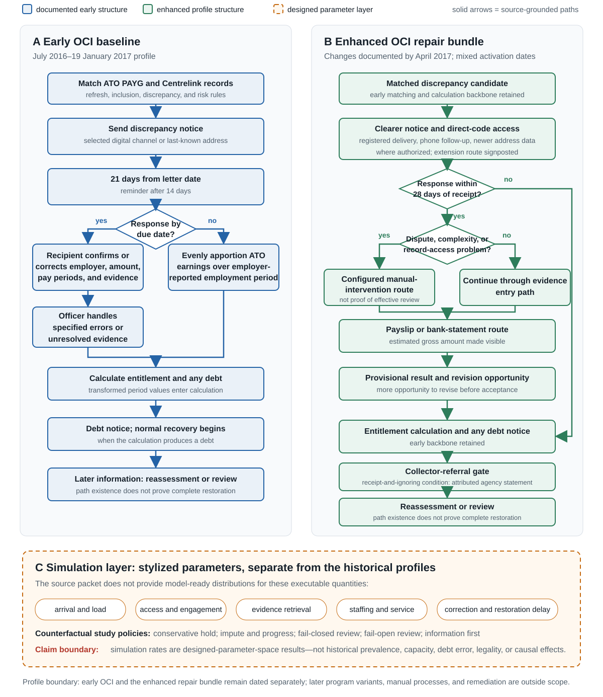

# From Incomplete Evidence to Automated Action: Robust Permission, Review Capacity, and Robodebt

**Eli Talbert**

Independent researcher

Correspondence: etalbert102@gmail.com

## Abstract

AI-generated classifications, summaries, and recommendations can route cases, assign review, start deadlines, and permit action. The governing question is what an automated workflow may do when the evidence supporting a decision becomes less informative. This article proposes robust permission as an operational test: weaker evidence should not newly enable an exact action unless independent support for that action survives every admissible refinement. If progression awaits review, the workflow must withhold automatic action, the reviewer must authorize the exact action, and the executing system must recheck support before acting. The study applies this test to the documented process behind Australia's Robodebt social-security debt scheme, then uses a design-frozen finite-cohort simulation to estimate how often limited review capacity activates timeout rules. Across 108 designed families, the review queue missed its 14-day window in 4–88% of initiated cases, with a mean of 0.476. A fail-open rule turned every miss into progression: 0.105 of initiated cases had sufficient evidence but lacked timely authorization, and 0.372 lacked both. Information-first handling reduced unresolved non-progression by 0.594 relative to conservative holding while adding interaction and workload events. These quantities describe designed scenarios, not Robodebt or another real population, and they do not rank the policies overall. The paper's main contribution is the workflow-level permission test. Robodebt shows how to apply it, the simulation measures when capacity and timeout make it operationally consequential, and a five-step protocol turns it into a prospective diagnostic.

*Keywords:* automated decision-making, human oversight, uncertainty, discrete-event simulation, Robodebt

## 1. Introduction

### 1.1 The organizational failure mode

A defensible abstraction can remove the distinction that would have triggered caution. A classifier may truthfully report a broad category; an agency may consistently transform an annual total into period values; a large language model may accurately summarize its source. Once that representation enters an operating workflow, it can change routing, review, deadlines, and action. Governance must therefore cover the chain from evidence and representation through routing, review, action, correction, and restoration.

An organization can test this chain before deployment. It can vary how the same output is represented, observe what the downstream rules permit, and stress any review gate under expected and adverse load. Australia's Robodebt scheme used annual employer-income data to calculate social-security debts after recipients failed to supply fortnightly records (Commonwealth Ombudsman, 2017). It provides a documented institutional sequence for such a test: evidence was transformed, action followed, recovery could begin, and later reassessment remained possible. The sequence reveals how information loss, routing, review, and deadlines can combine downstream of a technical output.

This paper calls the actions a workflow makes automatically available *functional permission*. Functional permission is distinct from formal authority, legal validity, and action actually taken. The failure of interest occurs when lost information removes a safeguard or enables progression that the remaining evidence cannot independently support. In the Robodebt application, the relevant actions are debt calculation, debt notice, and recovery enabled by imputed fortnightly values after nonresponse.

### 1.2 Why nominal review is insufficient

A review field alone provides no protection. The gate may fail open, appear after action, or control the wrong action. Review is effective only when the case appears before automatic progression; the reviewer can see evidence bearing on the exact action, has authority to stop or modify it, and completes a recorded decision before intervention is foreclosed. The workflow must enforce that dependency. The formal model calls this `ReviewEffective`. Timely supported service—a supported disposition reached by a declared deadline—is separate and is not estimated here. Capacity and timeout rules matter because they decide what the workflow does when review remains unfinished.

### 1.3 Study design and contribution

The primary contribution is the formal permission test. Four supporting layers do different work: a controlled pair isolates how representation can change permission; Robodebt supplies a documented institutional application; the simulation measures how review capacity and timeout rules activate the resulting consequences; and the protocol shows how to run the diagnostic prospectively. No layer substitutes for another.

Figure 1 previews the evidence-to-action chain that serves as the unit of analysis and the five diagnostic steps developed in Section 7.

**Figure 1**

*Evidence-to-Action Chain and Five Process-Red-Team Steps*

*Note.* The protocol follows one action through representation, permission, review, execution, and restoration while keeping formal authority, independent support, automatic permission, and executed action distinct.

### 1.4 Principal findings

Some results follow directly from the policy rules; others require the dynamic model. Fail-closed holding and fail-open release are built into the policies. The simulation estimates how often finite capacity reaches those branches. Queue misses averaged 0.476 of initiated cases, and fail open converted every miss into progression: 0.105 lacked timely authorization alone and 0.372 lacked both evidence and authorization. Information first preserved the permission boundary and reduced unresolved non-progression while adding interaction and agency-workload events. Its sequential accounting identifies where cases obtained support and where they remained unresolved, but it does not isolate the effect of each component.

The resulting rule is simple: loss of decision-relevant information should not expand automatic progression unless the exact action remains independently supported. Capacity and timeout rules then determine whether unfinished review produces a hold or an action.

Table 1 maps the argument's five layers to their evidence and limits.

**Table 1**

*Evidence Architecture and Diagnostic Scope*

| Layer | Question and principal diagnostics | Evidence used | Cannot establish |
| --- | --- | --- | --- |
| Formal model | What may weaker evidence permit, and what must review or restoration satisfy? F1–F5 | Declared refinement, support, action, gate, and consequence rules | Frequency, historical causation, or welfare |
| Controlled representation pair | Can representation alone change routing and automatic permission? F0 and F4; F1 is unassessable because evidence is fixed | Same synthetic case and output; only representation changes | Prevalence, queues, or review effectiveness |
| Robodebt application | Does a documented process contain the relevant evidence-to-action structure, and does the averaging rule pass the study's permission test? F0, F4, conditional rule-level F1, and structural F3/F5 | Fixed source packet, dated OCI profiles, and the study's support specification | An actual-case F1 verdict, independent causation, or numerical calibration |
| Dynamic simulation | How often do capacity and timeout rules activate, and with what modeled process outcomes? Paired outcomes relevant to F2 and the timing component of F3; timely supported service is unestimated | Designed families, paired policies, and finite queues | Historical rates, complete welfare, or full terminal comparison |
| Five-step protocol | Can the same questions be posed prospectively in another inspectable workflow? All diagnostics as applicable | Article procedure | Usability, field transfer, or prevalence |

## 2. Mechanism, Literature, and Research Questions

### 2.1 Representation-preservation controlled pair

A controlled pair holds a synthetic case, stored model output, policy, routing rule, process state, reviewer resource, clock, and random draws fixed. It changes only what the downstream workflow sees. One arm displays low confidence, provenance, and a policy-material alternative. The other displays only a defensible broad category. The first pauses for information gathering and fail-closed review; the second proceeds to routine disposition.

Formally, the preservation arm retains alternatives, confidence, unresolved status, and provenance. The fallback remains compatible with both alternatives but hides the distinction used by the routing rule. The pair therefore establishes a change in routing and automatic availability, not action taken or harm caused. Its executable, safety-specific fixture appears in the supplement.

Two controls define the boundary. If the output contains no policy-material alternative, the representation change leaves routing unchanged. If the safeguard does not depend on representation, both arms retain scrutiny. The pair isolates representation suppression because its evidence never changes, so F1 is unassessable. The simulation estimates timeout frequency and timely review completion; other conditions of effective review require separate evidence.

Robodebt and the simulation vary separate parts of the same chain. Robodebt concerns aggregate evidence transformed into imputed period values. The simulation includes unresolved or missing period evidence and finite review capacity. Across the three settings, a material distinction disappears or remains unresolved, and a downstream rule changes what the workflow permits.

### 2.2 Mechanism and scope

The mechanism has three parts: a defensible abstraction or unresolved evidence state; a distinction material to an independently specified rule; and a downstream safeguard that relaxes when that distinction disappears. Coarsening is harmless when the lost distinction does not affect the rule. Weaker evidence may also justify a hold or an information request. The controlled pair becomes problematic because suppressing the trigger changes routing and automatic availability.

The action direction matters. *Progression* advances or commits the process, imposes an external consequence, or forecloses a safeguard. *Constraint* contains progression; *information* obtains evidence; and *restoration* repairs a prior process or consequence. Information loss should not add unsupported automatic progression, although it may justify separately evaluated constraints or information seeking.

These conditions define a workflow vulnerability. Demonstrated exploitation would require evidence that an actor could induce the condition, observe its effect, repeat it, and benefit. The controlled pair and Robodebt application do not establish those four elements together.

### 2.3 Literature and proposed integration

Research on information structures, robust choice, selective classification, abstention, and uncertainty communication shows how evidence can be ordered, how ambiguity affects choice, and how uncertain outputs can be withheld or communicated (Blackwell, 1953; El-Yaniv & Wiener, 2010; Franc & Průša, 2019; Gilboa & Schmeidler, 1989; Prabhudesai et al., 2023). Anyabolu et al. (2026) make uncertainty-to-action bindings explicit, and Lin et al. (2026) examine evidence-to-action failures in tool-using agents. The present model adds an institutional action-set test tied to review and timeout rules in a documented administrative process.

Human oversight and contestability are institutional problems because a person must receive the case, see evidence bearing on the action, possess authority, and act in time. Work on automation bias, administrative burden, automated administration, and contestability develops those institutional conditions (Alon-Barkat & Busuioc, 2023; Bennett et al., 2026; Landau et al., 2024; Moynihan et al., 2015; Roehl, 2023; Roehl & Hansen, 2024; Sterz et al., 2024; Sztandar-Sztanderska, 2026). Green (2022) questions oversight mandates unsupported by evidence of effectiveness, while Hardy (2026) separates observation, interpretation, challenge, intervention, and recovery. This article asks whether review binds the exact action and what the workflow does when review remains incomplete.

Queueing, system safety, AI risk governance, and algorithmic impact assessment place capacity, control structures, context, ownership, and feedback inside the unit of analysis (Leveson, 2012; Little, 1961; National Institute of Standards and Technology, 2023; Reisman et al., 2018). Lykouris and Weng (2025) optimize review admission and scheduling under congestion; Wang and Rachev (2026) analyze capacity regimes. Here the safeguards remain fixed while event timing and shared queues determine how often their timeout branches activate.

Robodebt scholarship explains how destructive effects arose and persisted and how rule-of-law safeguards failed (Carney, 2019; Rinta-Kahila et al., 2022). The application below uses the public process record for a narrower purpose: to test which exact actions satisfy robust permission and whether later safeguards repair an upstream permission defect.

The resulting sequence joins four elements usually studied apart: evidentiary refinement and support, rules for withholding action or seeking evidence, finite-capacity review, and post-action correction.

### 2.4 Research questions and falsifiability

The study asks three questions. When may weaker evidence support automatic progression under the proposed robust-permission rule? Under the tested access and capacity conditions, does a configured gate block progression with unmet prerequisites, and how often does review finish in time? Which interventions avoid unsupported progression while keeping unresolved cases, interactions, workload, and recovery-path entry visible? The remaining review conditions are held invariant or demonstrated structurally rather than estimated.

The contribution would narrow if a valid representation pair produced no permission change, if ordinary component checks located every induced failure, or if access, capacity, and deadlines produced no consequential variation. The protocol would add little if it could not identify a transition, owner, intervention, tradeoff, and replayable repair beyond a local accuracy or calculation check.

## 3. Formal Model

The model connects evidence to exact actions. It first identifies the states still compatible with what is known. It then records which actions the workflow makes automatically available and asks whether each progression action remains supported under every admissible resolution of missing detail. In the Robodebt mapping, annual employer income is aggregate evidence, supported fortnightly records define finer states, and imputed period values remain imputed. If one admissible refinement excludes an action, the workflow must seek evidence, hold the case, or require effective review. Any reviewed action is checked again before execution.

### 3.1 Evidence, compatible states, and refinement

An evidence state `e` denotes the states compatible with what is known. Evidence `e_more` refines `e_less` when its compatible set is a nonempty subset of the coarser set under independently declared source and measurement assumptions. Refinement concerns which possibilities the evidence excludes. Confidence alone does not define it: two estimates with unequal confidence scores may be incomparable, and a confident transformation can still discard a policy-relevant distinction.

The admissible refinements of `e_less`, written `Ref(e_less)`, are fixed independently of the action the workflow prefers. A pass must cover them all. Coverage may come from full enumeration, a symbolic definition, or a sound conservative superset. One validated counterexample proves failure; a search that finds none does not prove a pass. A missing support rule, coverage argument, or action identity makes the result `unassessable`.

### 3.2 Representation and evidentiary fidelity

A versioned map transforms evidence into the representation consumed downstream. Each claim remains typed as observed, derived, imputed, disputed, or missing and carries its source, assumptions, transformation, and version. F0, *evidentiary fidelity*, asks whether claims are supported as typed, lineage is complete, distinct evidence states remain distinguishable, and downstream rules can inspect the required provenance. F4, *material surfacing*, asks whether the meaning of every independently material distinction reaches someone who can intervene before action or expiry.

An annual total or broad category may be accurate while losing the type, provenance, dispute, or temporal pattern needed for policy and review. A truthful aggregate can therefore pass a local consistency check yet fail the workflow-level fidelity or surfacing requirement.

### 3.3 Authority, permission, and action

Formal authority `L(q)` is the action set authorized in process state `q`. Historical values require an authoritative source; hypothetical models declare and label them. Automatic functional permission `P_auto(e,q,t)` is the full set that the operating workflow can execute without a new effective review or external authorization. Executed action `X(c,t)` records what actually happened. Permission therefore proves neither execution nor legality, and faithful implementation proves no independent evidentiary support.

Each action is identified by its target, parameters, timing, consequence, reversibility, authority condition, and rule version, then classified as progression, constraint, information, or restoration. An evaluation specification independent of the preferred result supplies materiality, refinements, support rules, comparison fields, review conditions, and restoration obligations. The workflow reevaluates support and permission after any material change in evidence, representation, time, process state, policy, or rule version. An institution must also assign an owner to this specification; formal independence does not make it adequate or enforce it.

### 3.4 Robust permission and safe fallbacks

Robust permission is the set of progression actions independently supported under every admissible refinement:

`P_robust(e_less,q,t) = intersection of J_progress(e_more,q,t) over e_more in Ref(e_less)`.

F1 passes when every progression action automatically permitted under `e_less` belongs to `P_robust`. A minimal passing workflow holds the case and requests records without permitting new progression. A minimal failure occurs when an annual total enables an exact action—for example, a debt notice with a specified target and amount derived from imputed period values—but one admissible period-specific refinement fails the independent support rule for that action. Workflow consistency cannot manufacture support because the evaluation rule is separate from the permission rule and independent of the preferred result.

F2 tests whether a proposed constraint or information action is safe by comparing it with an explicit hold from the same initial state, cohort, and exogenous inputs. The comparison expands to the affected system when the action consumes shared resources or changes another case's queue, deadline, or timeout. The fallback fails if it releases unsupported progression, lacks required authorization, or cannot be reversibly constrained.

### 3.5 Review, service, contestability, and restoration

F3 governs progression withheld from automatic action pending review. `GateSafe` asks whether the configured dependency blocks action while prerequisites remain unmet. `ReviewEffective` also requires timely surfacing, evidence bearing on the exact action, an authorized reviewer with stopping power, an enforced dependency, completion before foreclosure, and a recorded decision. Service asks whether the process reached a supported disposition by its deadline. A gate can remain safe while review and service fail.

The reviewer’s authorization binds the exact action, case, evidence and rule versions, conditions, and expiry. The executing system must revalidate support and the authorization's applicability at execution. Notice, a reviewer label, a stale decision, post-action reassessment, or authorization of another action instance does not satisfy F3.

F5 separates six questions often compressed into “appeal available.” Does a feasible correction path exist? Is it prospectively reliable under access, capacity, and timing? Was an opportunity available? Was it used? Did correction finish? Did every modeled consequence return to baseline? Correcting the recorded decision does not restore recovery status, money, access, time, or another consequence automatically. A pending horizon is `unassessable`; once it ends, any required consequence still away from baseline defeats complete restoration.

### 3.6 Direct implications and the simulation question

Robust permission is a definition and operational test. F1 passes when automatic progression under coarser evidence stays inside the robust set, and one valid excluding refinement proves failure. A pass requires sound coverage, fixed comparison rules, unambiguous action identity, and an independently specified support rule. The model does not prove that every institution should adopt the standard.

A fail-closed gate retains unfinished cases; a fail-open timeout may release them. A static benchmark gives the capacity limit. Over a common horizon, if backlog plus arriving review demand is `D` workload units and available service is `C`, at least `max(0,D−C)` units cannot finish. The bound establishes overload but cannot tell us which cases enter review after engagement and retrieval, when their deadlines fall, or where they accumulate. The simulation supplies those paths, pairs policies on the same cases and draws, and estimates activation frequencies and end states within the designed parameter space.

The definitions also cannot determine whether information acquisition improves operational outcomes. Information first may preserve the permission boundary while changing interactions, workload, recovery-path entry, and unresolved non-progression. Those quantities depend on the modeled process and parameters and must be estimated within the simulation.

## 4. Robodebt as a Documented Process Application

### 4.1 Why this case

The documented OCI sequence runs from aggregate income through imputed period values, notices, automated calculation, debt action, recovery, and reassessment, making Robodebt structurally compatible with the proposed mechanism. Because the framework was developed with knowledge of Robodebt, the case illustrates and stress-tests the framework; it does not independently validate it. Policy intent, legal interpretation, incentives, and evidentiary risk may also explain the process and its effects.

### 4.2 Sources and application validity

The fixed ten-source packet assigns each kind of claim to its source. Ombudsman reports provide the principal process account (Commonwealth Ombudsman, 2017, 2019); Deloitte maps provide node-level structure (Deloitte for the Royal Commission into the Robodebt Scheme, 2023a, 2023b, 2023c); and the Royal Commission supplies attributed historical findings (Royal Commission into the Robodebt Scheme, 2023). Services Australia (2025) provides limited current context. The Ombudsman's later income-apportionment report is used only to distinguish apportionment from Robodebt income averaging (Commonwealth Ombudsman, 2023).

The dated early and enhanced OCI profiles anchor the process facts and analytical mapping. Those profiles do not supply the historical arrival, capacity, service, engagement, retrieval, correction, and restoration distributions required to calibrate the simulation.

### 4.3 Early OCI process profile

The early profile covers the July 2016 OCI launch through 19 January 2017, ending before the first specifically dated letter change. Under the documented OCI design, matched Australian Taxation Office (ATO) pay-as-you-go income and Centrelink information passed through refresh, inclusion, discrepancy, and risk rules before a notice was sent through the selected digital channel or last-known address. The initial letter allowed 21 days from its date to respond, with a reminder after 14 days (Commonwealth Ombudsman, 2017, paras. 1.17–1.29; Deloitte for the Royal Commission into the Robodebt Scheme, 2023a, 2023b, 2023c).

A responding recipient could correct employer, amount, and pay-period information and supply evidence; specified errors or unresolved inputs went to compliance-officer handling. Recipients nevertheless had to reconstruct historical income despite weaker information-gathering powers and possible bank-statement costs (Commonwealth Ombudsman, 2017, paras. 3.26–3.28). After nonresponse, the design evenly apportioned ATO earnings over the reported employment period and calculated entitlement and any debt. The mapped process separates provisional computation from committed debt raising and debt advice: a debt notice made the account payable, after which recovery could commence. Later information could trigger reassessment or internal review (Commonwealth Ombudsman, 2017, paras. 1.17–1.29, Appendix B; Deloitte for the Royal Commission into the Robodebt Scheme, 2023c).

The critical transition came after nonresponse: aggregate evidence became created fortnightly values, which could feed calculation and, if the process raised a debt, an actionable notice and recovery. The mapping follows that connection among representation, deadline, and permission while keeping provisional calculation, committed debt, and external consequence separate.

Under the study's period-evidence specification, the averaging rule fails F1 at the rule level. Suppose the reported employment interval includes fortnights in which the recipient received no benefit. A same-total admissible refinement can place all earnings in those fortnights. The period-specific rule then supports no debt for benefit fortnights, while even averaging can assign income to those fortnights and permit debt progression. Other interval structures need their own action-specific refinement analysis, and the aggregate total alone establishes no amount error. The counterexample evaluates the documented rule under a study-authored support specification; it determines neither the debt nor the legality of a historical case.

The record fixes the 21-day clock, 14-day reminder, averaging transition, debt-notice path, recovery, and reassessment opportunity. Queue capacity, service, engagement, retrieval, correction, and restoration distributions are stylized.

### 4.4 Enhanced OCI and repair mechanisms

The enhanced profile assembles changes documented in early 2017 without assigning them a fictitious common start date. The Commonwealth Ombudsman's (2017) April report dates the first letter revision to 20 January and records further changes during February. The bundle added direct access using a confirmation code and customer reference number, clearer contact information, registered-mail and telephone follow-up, more recent address information where authorized, and 28 days from receipt with a signposted extension route.

The documented design routed disputed inputs, complex circumstances, selected other-income answers, and record-access difficulties to manual intervention. It added bank-statement entry, clearer handling when payslips were unavailable, a visible estimated gross amount, and more opportunity to revise inputs. The Ombudsman reported that bank statements were accepted when other historical-income evidence was unavailable. It separately reported the agency's statement that collector referral after nonresponse required a notice to have been received and ignored; enforcement in particular cases is not established (Commonwealth Ombudsman, 2017, paras. 1.30–1.46).

These access and surfacing improvements left the evidentiary basis for aggregate-only debt calculation unchanged. The same rule-level counterexample therefore defeats F1 under the study's specification: better access and surfacing cannot make averaging robust to every same-total refinement. An actual historical debt remains `unassessable` without its exact action, income timing, benefit record, and applicable support rule. A downstream condition requiring receipt and nonresponse cannot supply missing upstream period evidence. Enforcement and later variants fall outside the profile.

Figure 2 contrasts the documented early OCI pathway with the enhanced repair bundle and identifies the separate simulation layer.

**Figure 2**

*Early and Enhanced OCI Process Profiles*

*Note.* Source-grounded process structure establishes analytical relevance; the simulation layer remains explicitly stylized rather than a numerical reconstruction of Robodebt. The historical process structure is synthesized from Commonwealth Ombudsman (2017, paras. 1.17–1.46, Appendix B) and Deloitte for the Royal Commission into the Robodebt Scheme (2023a, 2023b, 2023c).

### 4.5 Formal crosswalk and inference limits

The documents establish process facts; the study supplies the analytical crosswalk. An annual employer-income total and broad employment period form the coarser evidence. Supported fortnight-specific income and working dates form finer states. Apportionment creates period values from the aggregate. The study specification supplies the independent support rule and same-total refinement used for the rule-level F1 failure, while the historical sources supply no case-level verdict.

The profile identifies debt calculation, notice, recovery, hold, and evidence-request actions. The response deadline and nonresponse branch map to timeout semantics; stylized overlays supply executable values. The enhanced receipt-and-ignoring condition maps to a downstream collector-referral gate. It cannot supply missing period evidence or, by position alone, establish an upstream historical F1 failure.

Notice and interface records bear on material surfacing, but an officer route alone does not prove effective review. Reassessment supplies a correction path; complete restoration would require every declared consequence to return to baseline.

The historical profile supplies no action-support criterion. The rule-level F1 result is therefore conditional on the study’s specification of support, materiality, action identity, and refinements. Review and restoration criteria likewise remain analytical rather than historical attributes.

### 4.6 Transition to simulation

The formal rule says what should happen when review remains incomplete. The simulation estimates how often finite capacity creates that condition. Historical numerical distributions are unavailable, so the experiment asks a counterfactual governance question over a declared parameter space. Its five policies compare conservative holding, automatic progression, fail-closed and fail-open review, and agency-assisted information acquisition. None represents a historical Robodebt policy.

## 5. Dynamic Simulation Methods

### 5.1 Purpose, kernel, and unit of analysis

The finite-cohort discrete-event simulation measures how often review capacity activates timeout consequences and where unresolved cases accumulate. Each run followed 80 cases under one scenario family, policy, and replication. Policies were paired within families, which formed the summary unit. Cases moved through engagement, representation, routing, review, action, recovery-path entry, correction, and restoration. Staffed stages used finite-capacity, work-conserving FIFO queues with deterministic tie-breaking. At the day-650 cutoff, censored work and paths without a terminal event remained unresolved.

The kernel was case-neutral: no Robodebt identifier or case-specific rule entered its event logic. Policies, evaluation specifications, execution settings, and scenario mappings were separately controlled inputs.

Each policy received the same cases, latent attributes, potential evidence, and access conditions. The model retained the documented 21-day response deadline; other numerical values were stylized. Progression required period-specific evidence. A supported state had one supporting refinement. An unresolved state contained both supporting and non-supporting refinements, placing progression outside `P_robust`. Review could request evidence but could not authorize unsupported progression. A stored specification fixed the evidence universe, coverage argument, and exact action, which routing and execution evaluated across every certified refinement.

Matched policies also shared exogenous draws. Each draw was keyed by case, event family, and index, so a policy-induced event could not shift unrelated draws. This common-random-number design reduced computational noise while preserving policy-induced path differences.

### 5.2 Policy designs

Table 2 compares five specified counterfactual interventions.

**Table 2**

*Counterfactual Study Policies and Principal Modeled Tradeoffs*

| Policy | Operational rule | Principal modeled tradeoff |
| --- | --- | --- |
| Claimant-led evidence and hold (U0) | Hold while required evidence is missing. | Avoids unsupported progression but may retain unresolved cases and interactions. |
| Impute and progress (U1) | Impute and permit automatic progression. | Failure benchmark for progression without action-specific support. |
| Review with fail-closed timeout (U2C) | Impute with evidence status preserved, route all potential progression to review, and hold if review does not complete in time. | Preserves the gate but can accumulate holds. |
| Review with fail-open timeout (U2O) | Impute with evidence status preserved, route all potential progression to review, and permit progression if review times out. | Converts non-completion into potentially unsupported action. |
| Agency-assisted information first (U3) | Assist engagement and retrieve evidence; progress when support is obtained and route unresolved cases to fail-closed review and holding. | Consumes resources and may add interactions, delay, or exposure. |

The U2O−U2C contrast isolates the consequence of unfinished review because both policies share the same review machinery. U3−U0 compares assisted engagement, evidence retrieval, and unresolved-case review as a bundle with conservative holding. U1−U0 checks implementation; it is not a substantive policy comparison.

U2C and U2O send every potential progression to review, including cases with sufficient period evidence. Supported and unresolved cases therefore consume the same modeled review service, and supported cases can time out without authorization. This universal-review design tests whether review remains action-binding under load. Its activation rates do not describe a gate that reviews only unresolved evidence, a variant the study did not simulate.

### 5.3 Frozen scenario design and execution

Policies, scenarios, seeds, outcomes, contrasts, and analysis rules were frozen before the core results were inspected. This internal design freeze constrained tuning but did not constitute an external preregistration. After results, reporting repairs corrected an invalid exposure label: the reported −0.594 is the sign-reversed form of the earlier +0.594 under the corrected label. The repairs also added the failure partition and evidence-stage fields after informal pre-submission feedback. They changed no policy, case, random stream, queue, or event. Selecting additional reported outcomes after inspection still creates outcome-selection risk.

The core crossed five designed factors. Nominal initiation load `L` took values of 0.60, 0.95, and 1.20. With 80 cases, two reviewers, and mean service demand `s/2`, the initiation window was `Ns/(2kL)`. Higher load compressed initiation, while routing still determined realized review demand. Missing-evidence and access-barrier probabilities each took values of 0.10, 0.30, and 0.50. Retrieval success was 0.35 or 0.85. Partial staff access increased the uniform review-service scale from 10 to 15 days; complete access kept it at 10. Staff access changed review duration, not evidence.

Keyed `U[0,1)` draws generated binary events and stochastic timings. The model retained the 21-day response deadline and used a 14-day review window. Prespecified settings governed notice, assistance, retrieval, recovery, correction, reassessment, restoration, and the day-650 cutoff. Complete values and provenance receipts are in the frozen configuration.

The 108-family design combined five policies with 30 paired replications, producing 16,200 core runs and 1,296,000 case-policy trajectories. Load was a designed input, not measured utilization or an estimated threshold. The frozen manifest fixed 3,240 family-replication seeds per suite.

Monte Carlo standard error (MCSE) targets were 0.05 for rates and 0.06 for paired differences; all cells passed at 30 replications. A separate 16,200-run sensitivity doubled retrieval-latency scale from 10 to 20 days. It tests routing and queue phasing, not acquisition failure or deadline expiry.

### 5.4 Outcomes and comparisons

Every initiated case ended in one decision state: supported progression, unsupported progression, evidence requested after review, unresolved hold, or open before action at cutoff. Unsupported progression covered both progression outside `P_robust` and progression without required timely authorization. Its exclusive evidence-only, authorization-only, and joint components keep evidentiary and review failures separate. The primary unresolved outcome combined requests, holds, and cases still open before action. A second partition recorded recovery-path entry after supported progression, entry after unsupported progression, or no entry.

Timely review completion used review requests as its denominator and was null when no request existed. For U3, sequential fields recorded adequate response evidence, retrieval requests, retrieved evidence, unresolved evidence after acquisition, review entry, and the final request-or-hold state. Review could request evidence but could not authorize unsupported progression, and the model contains no response cycle after that request. Review completion therefore measures queue performance and changes the unresolved-state label, not evidentiary resolution. Gate safety tested whether an applicable gate blocked progression while prerequisites remained unmet.

Interaction events count responses and assistance requests. Agency-workload events count completed assistance, retrieval requests, reviews, and reassessments. They measure event frequency, not effort or welfare. Recovery-path entry can follow supported or unsupported progression and is not itself a harm measure. The policies also lack comparable events for terminal resolution and complete restoration.

We report paired differences, 95% normal MCSE intervals, family ranges, and unweighted designed-family means. MCSE measures finite-run precision; the cross-family mean assumes no real-world scenario distribution.

### 5.5 Validation, controls, and claim boundary

The repaired reports were compared with the prior outputs. Across 32,400 paired attempts, cohorts, event details, order, timestamps, actions, queues, evaluation receipts, and shared outcomes were identical. Hand traces, replay, conservation checks, five negative controls, routing and execution receipts, and 218 automated checks passed. Both suites reproduced at 30 replications and reconciled without missing or unexpected identifiers.

## 6. Results

### 6.1 How often the timeout rule activates

Queue misses rose sharply as more cases arrived within the service window. Under fail-closed review (U2C), about one in seven initiated cases timed out at nominal load 0.60, one in two at 0.95, and nearly four in five at 1.20; the exact rates were 0.143, 0.498, and 0.788. Timely completion among requested reviews moved in the opposite direction: 0.857, 0.502, and 0.212. Across the full grid, 135,766 of 259,200 requested reviews finished on time, a request-weighted rate of 0.524. Timeout activation averaged 0.476 across families, ranged from 0.042 to 0.881, and had a simulation MCSE of 0.0024 for the balanced-grid mean.

The paired policies shared cases, draws, review requests, and service; only the consequence of timeout changed. Fail closed retained the case, whereas fail open permitted progression. The mean timeout rate of 0.476 is therefore also the mean increase in the union outcome. Within that total, 0.105 of initiated cases had sufficient evidence but no timely authorization, 0.372 lacked both, and none lacked evidence alone. The evidence-only value is zero by construction because completed review cannot authorize progression while evidence remains unsupported. Every progression released by fail-open timeout lacked required authorization, and 0.372 of initiated cases also lacked evidentiary support. These components partition one activation result; they are not additional effects.

Fail-closed review remained gate-safe in every tested family, but blocked cases could remain unresolved. The three load points show activation at sampled conditions; they do not locate a continuous capacity threshold.

### 6.2 Information first changes where unresolved cases accumulate

Information first moved cases out of holding by obtaining evidence without relaxing the permission rule. It produced no unsupported progression, nor did conservative holding (U0), but the two policies ended in contrasting states. Under U0, 0.234 of initiated cases reached supported progression and 0.766 remained held. Under U3, supported progression rose to 0.829; 0.162 ended with an evidence request after review, and 0.009 remained held. The aggregate U3−U0 decision-state contrast was a 0.594 reduction in unresolved non-progression, with a family range of 0.369–0.815 and a balanced-grid MCSE of 0.0009.

The stage accounting shows where the U3 cases moved. Adequate response evidence supported progression for 0.573 of initiated cases. The remaining 0.427 entered retrieval. Evidence returned for 0.256, which then progressed; 0.171 remained unresolved and entered review. Timely review moved 0.162 into an evidence-request state, while timeout left 0.009 held. These are successive stages, not separate estimates of assistance and retrieval effects. Because the model contains no response cycle after the final evidence request, review changes the label of the unresolved state rather than its outcome. Faster review consequently has little leverage in this design.

Relative to U0, U3 added 1.096 interaction events per initiated case, with a family range of 0.860–1.312, and 1.209 agency-workload events, with a range of 0.749–1.728. Recovery-path entry shifted from mostly no entry under U0 to mostly entry after supported progression under U3. Both measures record process movement; neither measures effort, welfare, harm, or resolution.

Doubling retrieval latency left the central pattern unchanged. U3 and U0 still produced zero unsupported progression, U3's unresolved rate remained 0.171, and its stage proportions differed from the core values by less than 0.004. Full sensitivity estimates appear in the supplement. The simulation's distinct contribution is therefore the frequency of timeout activation, the split between evidence and authorization failures, and the points at which unresolved U3 cases accumulate.

**Figure 3**

*Timeout Activation, Decision States, and Information Stages*

*Note.* The figure reports the frozen core simulation of 108 designed families with 30 paired replications per family. Panel A uses initiated cases for timeout activation and review requests for timely completion. Panel B partitions every initiated U0 and U3 case into one decision state. Panel C follows U3 cases through sequential evidence and review stages; its bars are stage rates, not additive components or independent effects.

Table 3 reports the main quantities, including the exclusive partition of the fail-open progression union.

**Table 3**

*Core Simulation Quantities and Fail-Open Failure Partition*

| Quantity | Estimate | Family range | Simulation MCSE | Claim boundary |
| --- | ---: | ---: | ---: | --- |
| Fail-closed timeout activation per initiated case | 0.476 | 0.042–0.881 | 0.0024 | Queue deadline misses; fail-open progression and fail-closed holding are rule-defined consequences. |
| U2O evidence-only failure | 0.000 | 0.000–0.000 | — | Rule-implied zero: completed review cannot authorize unsupported progression. |
| U2O authorization-only failure | 0.105 | 0.004–0.368 | 0.0008 | Sufficient evidence, but required timely review authorization was missing. |
| U2O joint evidence-and-authorization failure | 0.372 | 0.025–0.759 | 0.0020 | Neither evidentiary support nor required timely authorization was present. |
| U3−U0 unresolved non-progression | −0.594 | −0.815 to −0.369 | 0.0009 | Sole aggregate U3−U0 decision-state contrast. |
| U2C timely review conditional on request | 135,766/259,200 = 0.524 | — | — | Request-weighted diagnostic, not a supported-disposition measure. |
| U3−U0 interaction events per initiated case | +1.096 | 0.860–1.312 | 0.0018 | Event count, not effort, subjective burden, welfare, or cost. |
| U3−U0 agency-workload events per initiated case | +1.209 | 0.749–1.728 | 0.0017 | Event count, not staffing cost, efficiency, or overall value. |

*Note.* Means and ranges are unweighted across 108 designed families; each family uses 30 paired replications. MCSE measures simulation error for the balanced-grid estimate, not population, historical, or model uncertainty. Displayed values are rounded independently to three decimals; partitions and contrasts were computed from unrounded values. A dash marks either a rule-implied value without sampling error or an exact ratio of stored counts rather than a balanced-grid paired estimand.

The formal rule identifies what to inspect. Robodebt shows where those elements appear in an institutional process. The simulation shows how often capacity and timeout make them consequential under the designed conditions. Section 7 turns that sequence into a five-step protocol.

## 7. Process-Red-Team Protocol and Governance Implications

### 7.1 What the protocol produces

The protocol follows one consequential action through representation, routing, review, execution, contestability, and restoration. Its output is a set of separate findings, missing inputs, transitions, interventions, owners, and tradeoffs; it gives no overall score for the organization. Documents establish process structure, deterministic traces establish event order, and simulation is reserved for timing and shared-resource questions. When a required input is missing, the protocol returns `unassessable` and names the input. The appendix provides implementation fields and worksheets. The protocol is designed for use but has not undergone a usability evaluation.

### 7.2 Step 1: map transformations and ownership

At each handoff, record the source value, its type—observed, derived, imputed, disputed, or missing—the transformation, provenance, and owner. Find the first point where a policy-relevant distinction disappears or becomes unavailable to someone empowered to act. A repair should retain typed provenance, expose disputes, bind transformations to sources, and assign responsibility.

### 7.3 Step 2: test what weaker evidence permits

List the exact progression, constraint, information, and restoration actions. For each automatic progression action, record its target, parameters, prerequisites, evidentiary support, default, and timeout. F1 fails when any valid refinement excludes an automatically permitted action; a pass requires sound coverage of the declared refinement set. Test fallbacks against an explicit hold from the same starting state, adding affected queues and cases when resources are shared. Candidate repairs include narrower permission, evidence acquisition, reversible constraint, effective review, and fail-closed timeout.

### 7.4 Step 3: test whether review is operational

Replace the label “human review” with operational questions. Is the gate configured and blocking? Does an authorized reviewer receive material evidence and control the exact action? Does the workflow wait? Is the authorization still valid at execution? Does the process reach a supported disposition by its service deadline?

Report gate safety, effective review, and timely supported service separately. A fail-closed gate can remain safe while service fails, and a completed review can be stale, unsupported, or nonbinding. Locate the defect in visibility, stopping authority, dependency, timing, execution-state revalidation, or capacity.

### 7.5 Step 4: stress access, workload, and deadlines

Choose the lightest method that answers the question: documents for timeout rules, traces for event order, queue calculations for simple capacity questions, and dynamic simulation for shared resources, feedback, or spillovers. A claimed boundary must state how it was located and at what resolution.

Stress access, evidence, arrivals, service demand, capacity, deadlines, and timeouts. Keep gate safety, timely completion, unresolved cases, workload, recovery-path entry, and restoration separate. State improvements, deterioration, and unmeasured consequences.

### 7.6 Step 5: test contestability and restoration

Test six elements often hidden by “appeal available”: path existence, reliable access, an available opportunity, uptake, completed correction, and restoration of every required consequence. Claims about realized or timely outcomes require a trace or system model with declared horizons.

Declare the consequence vector and baseline before assessing restoration. Correcting a decision leaves recovery status, time, access, and other consequences to be checked separately. Pending horizons are `unassessable`. Candidate repairs include pausing recovery, acquiring evidence, reserving reassessment capacity, extending windows, and assigning correction and restoration to distinct owners.

### 7.7 Fixed Robodebt worked example

The nonhistorical worked pair fixes the case, evidence, process, resources, rules, and draws, then changes one policy. After an assumed failed notice and deadline expiry, impute and progress permits action on imputed period values; information first holds the case while seeking evidence. The comparison joins access failure, imputation, deadline expiry, and permission in one trace. Recovery and restoration remain unassessed because they require additional records, rules, baselines, and observation horizons.

### 7.8 Governance interventions and transfer limits

The diagnosis assigns four intervention responsibilities. Each remains a proposal until evaluated.

**Representation and interface owners:** preserve evidence state, provenance, and disputes. The controlled pair demonstrates a configured change in routing and availability. It does not measure the cost of added interface complexity.

**Information-service and policy owners:** use evidence acquisition with holding where appropriate. U3 demonstrates the bundle's modeled effect and its added interaction and agency-workload events, but cannot identify the contribution of each component. Access and deadline changes require separate tests.

**Gate and operational owners:** preserve fail-closed timeout behavior when prerequisites remain unmet. Reserved staff capacity, metered arrivals, and priority scheduling are design proposals that still require evaluation for resource use, queue displacement, and unresolved holding.

**Recovery and restoration owners:** define when action pauses during contest and how later consequences are repaired. The enhanced profile records a collector-referral condition but does not establish its enforcement. Preventing recovery entry and restoring consequences after recovery are separate tasks.

For a current AI deployment, an organization can apply the procedure before rollout or a material workflow change. Run matched representations of the same output—with and without provenance, alternatives, disputes, or temporal detail—through the actual downstream rules. Then stress the resulting gate under expected and adverse load. This prospective use tests the formal mechanism without treating a contemporary deployment as another Robodebt.

## 8. Limitations and Conclusion

### 8.1 Limitations

The formal results hold within the proposed standard and declared specification: admissible refinements, an independent support rule, exact action identities, and action ordering. Missing inputs produce `unassessable`. Each new domain needs its own specification, coverage argument, and responsible owner.

Robodebt demonstrates structural compatibility with a framework developed in light of the case; it cannot serve as independent validation. The rule-level F1 failure depends on the study's support specification and same-total counterexample. The source packet supplies no case-level monetary-entitlement oracle, numerical calibration, or independent legal judgment. Historical quantification would require new data, measurement, and a new design freeze.

The simulation measures process movement, not complete service or welfare. Timely review completion is conditional on a request and differs from supported disposition. U3 stages provide sequential accounting rather than component-causal effects. The model stops after a review-generated evidence request, leaving later response, resolution, and delay outside the comparison. Interaction events record frequency rather than effort or welfare, and the policies lack comparable events for terminal resolution and complete restoration. MCSE measures finite-run precision. Unweighted cross-family means assign no probability distribution to real-world scenarios.

The kernel represents declared rules, finite queues, deadlines, exogenous variation, and correction paths. It omits reviewer behavior, adaptation, endogenous demand, and organizational learning. Without a welfare function or complete terminal consequences, it cannot rank the policies overall.

The prospective protocol has not been evaluated for practitioner performance, usability, adoption, or inter-rater agreement. It remains a candidate diagnostic, and a susceptible workflow does not by itself establish exploitation.

### 8.2 Conclusion

When representation suppresses a material distinction or period evidence remains unavailable, the critical question is what the workflow may newly do. Under the proposed standard, weaker evidence supports automatic progression only when the exact action survives every admissible refinement. Constraint, information acquisition, and restoration remain available when evaluated on their own terms.

The representation pair isolates how one hidden distinction can change routing and automatic availability. Robodebt supplies the documented institutional sequence from aggregate income to imputed period values and action after nonresponse. Under the study's specification, an employment interval containing non-benefit fortnights admits a same-total refinement that supports no debt where averaging permits progression. The averaging rule therefore fails F1. Other interval structures need their own action-specific analysis, and a historical debt cannot be assessed without its exact action, income timing, benefit record, and support rule. A later receipt-and-ignoring guard leaves the missing upstream period evidence unresolved.

The simulation supplies the quantities that the rule and documents cannot. Fail-closed review timed out for an average 0.476 of initiated cases, and fail open converted every miss into progression. Of initiated cases, 0.105 had evidence but no timely authorization and 0.372 lacked both. Information first reduced unresolved non-progression by 0.594 while adding interaction and agency-workload events. Before retrieval, 0.573 obtained support; retrieval supported another 0.256; and 0.171 remained unresolved at review entry. Because the model ends without a post-request response cycle, completed review changes the unresolved-state label rather than the evidence.

The paper moves from a permission rule to a documented application, an operational stress test, and a practical diagnostic. The governing checks are concrete: Does uncertainty remain visible? Does the gate bind the exact action? Can an empowered reviewer intervene before timeout? Does correction restore every declared consequence? In the demonstrated model, fail-closed and information-first handling preserve the robust-permission boundary. Incomplete service and terminal outcomes prevent an overall safety comparison.

Organizations considering AI-generated classifications, recommendations, summaries, or agent actions should test the workflow as well as the output. The test should remove provenance, alternatives, disputes, or temporal detail in controlled pairs and observe what downstream systems permit. It should then place the review gate under realistic and adverse workload to see whether human control still binds the action.

The process-red-team diagnostic reduces to three questions: When evidence weakens, what may the system now do? Who can stop it? Can they act before the result becomes difficult to reverse? Those questions make the full chain—representation, permission, capacity, action, and restoration—the unit of governance.

## Data and Code Availability

Code and data are staged at https://github.com/etalbert102/uncertainty_permission_simulation but were not publicly accessible on 24 November 2026; activation and a logged-out check remain required.

## References

Alon-Barkat, S., & Busuioc, M. (2023). Human–AI interactions in public sector decision making: “Automation bias” and “selective adherence” to algorithmic advice. *Journal of Public Administration Research and Theory, 33*(1), 153–169. https://doi.org/10.1093/jopart/muac007

Anyabolu, C., Dubey, A., & Hattab, G. (2026). Visualizing uncertainty-to-action composition for human oversight. arXiv. https://arxiv.org/abs/2608.16428

Bennett, H., Currie, M., & Podoletz, L. (2026). Universal Credit: Administrative burdens of automated welfare. *Journal of Social Policy, 55*(1), 24–42. https://doi.org/10.1017/S0047279424000175

Blackwell, D. (1953). Equivalent comparisons of experiments. *Annals of Mathematical Statistics, 24*(2), 265–272. https://doi.org/10.1214/aoms/1177729032

Carney, T. (2019). Robo-debt illegality: The seven veils of failed guarantees of the rule of law? *Alternative Law Journal, 44*(1), 4–10. https://doi.org/10.1177/1037969X18815913

Commonwealth Ombudsman. (2017). *Centrelink’s automated debt raising and recovery system*. https://www.ombudsman.gov.au/__data/assets/pdf_file/0022/43528/Report-Centrelinks-automated-debt-raising-and-recovery-system-April-2017.pdf

Commonwealth Ombudsman. (2019). *Centrelink’s automated debt raising and recovery system—Implementation report*. https://www.ombudsman.gov.au/__data/assets/pdf_file/0027/286551/Centrelinks-Automated-Debt-Raising-and-Recovery-System.pdf

Commonwealth Ombudsman. (2023). *Lessons in lawfulness: Own motion investigation into Services Australia’s and the Department of Social Services’ response to the question of the lawfulness of income apportionment before 7 December 2020*. https://www.ombudsman.gov.au/__data/assets/pdf_file/0040/299947/Income-Apportionment-Lawfulness.pdf

Deloitte for the Royal Commission into the Robodebt Scheme. (2023a). *2B. Identity matching—OCI and EIC*. https://robodebt.royalcommission.gov.au/system/files/2023-03/2B-Identity-Matching-Process-Map-OCI-and-EIC.pdf

Deloitte for the Royal Commission into the Robodebt Scheme. (2023b). *3B. Income matching—OCI*. https://robodebt.royalcommission.gov.au/system/files/2023-03/3B-Income-Matching-Process-Map-OCI.pdf

Deloitte for the Royal Commission into the Robodebt Scheme. (2023c). *4B. Debt calculation and notification—OCI baseline*. https://robodebt.royalcommission.gov.au/system/files/2023-03/4B-Debt-Calculation-and-Notification-Process-Map-OCI.pdf

Deng, J. (2026). When can fraud operations authorize automation? A decision-support framework for fresh audit evidence and review workload. arXiv. https://arxiv.org/abs/2608.08577

El-Yaniv, R., & Wiener, Y. (2010). On the foundations of noise-free selective classification. *Journal of Machine Learning Research, 11*, 1605–1641. https://jmlr.org/papers/v11/el-yaniv10a.html

Franc, V., & Průša, D. (2019). On discriminative learning of prediction uncertainty. In K. Chaudhuri & R. Salakhutdinov (Eds.), *Proceedings of the 36th International Conference on Machine Learning* (Vol. 97, pp. 1963–1971). PMLR. https://proceedings.mlr.press/v97/franc19a.html

Gilboa, I., & Schmeidler, D. (1989). Maxmin expected utility with non-unique prior. *Journal of Mathematical Economics, 18*(2), 141–153. https://doi.org/10.1016/0304-4068(89)90018-9

Green, B. (2022). The flaws of policies requiring human oversight of government algorithms. *Computer Law & Security Review, 45*, Article 105681. https://doi.org/10.1016/j.clsr.2022.105681

Hardy, K. (2026). From human oversight to effective control: A comparative documentary framework for high-impact AI systems. *Design+*. Advance online publication. https://doi.org/10.36922/DP026290034

Landau, S., Dempsey, J. X., Kamar, E., & Bellovin, S. M. (2024). *Recommendations for government development and use of advanced automated systems to make decisions about individuals*. Stanford Center for International Security and Cooperation. https://cisac.fsi.stanford.edu/publication/recommendations-government-development-and-use-advanced-automated-systems-make

Leveson, N. (2012). *Engineering a safer world: Systems thinking applied to safety*. MIT Press.

Liao, J., Huang, Q., Qian, R., Mao, X., Cheng, J., Cui, K., Li, Y., Sun, J., & Hou, Y. (2026). Auditing provenance sensitivity in LLM agent action selection. arXiv. https://arxiv.org/abs/2607.20827

Lin, H., Cao, S., Luo, Z., Chai, W., Lee, M.-L., & Hsu, W. (2026). From evidence to action: How tool-using agents fail. arXiv. https://arxiv.org/abs/2610.07753

Little, J. D. C. (1961). A proof for the queuing formula: L = λW. *Operations Research, 9*(3), 383–387. https://doi.org/10.1287/opre.9.3.383

Lykouris, T., & Weng, W. (2025). Learning to defer in congested systems: The AI-human interplay. arXiv. https://arxiv.org/abs/2402.12237

Montanari, G., Scarsini, M., & Perchet, V. (2026). Learning when to automate: Queue control in human-AI service systems. arXiv. https://arxiv.org/abs/2607.06017

Moynihan, D. P., Herd, P., & Harvey, H. (2015). Administrative burden: Learning, psychological, and compliance costs in citizen–state interactions. *Journal of Public Administration Research and Theory, 25*(1), 43–69. https://doi.org/10.1093/jopart/muu009

National Institute of Standards and Technology. (2023). *Artificial intelligence risk management framework (AI RMF 1.0)*. https://doi.org/10.6028/NIST.AI.100-1

Prabhudesai, S., Yang, L., Asthana, S., Huan, X., Liao, Q. V., & Banovic, N. (2023). Understanding uncertainty: How lay decision-makers perceive and interpret uncertainty in human-AI decision making. In *Proceedings of the 28th International Conference on Intelligent User Interfaces* (pp. 379–396). Association for Computing Machinery. https://doi.org/10.1145/3581641.3584033

Reisman, D., Schultz, J., Crawford, K., & Whittaker, M. (2018). *Algorithmic impact assessments: A practical framework for public agency accountability*. AI Now Institute. https://ainowinstitute.org/publication/algorithmic-impact-assessments-report-2

Rinta-Kahila, T., Someh, I., Gillespie, N., Indulska, M., & Gregor, S. (2022). Algorithmic decision-making and system destructiveness: A case of automatic debt recovery. *European Journal of Information Systems, 31*(3), 313–338. https://doi.org/10.1080/0960085X.2021.1960905

Roehl, U. B. U. (2023). Automated decision-making and good administration: Views from inside the government machinery. *Government Information Quarterly, 40*(4), Article 101864. https://doi.org/10.1016/j.giq.2023.101864

Roehl, U. B. U., & Hansen, M. B. (2024). Automated, administrative decision-making and good governance: Synergies, trade-offs, and limits. *Public Administration Review, 84*(6), 1184–1199. https://doi.org/10.1111/puar.13799

Royal Commission into the Robodebt Scheme. (2023). *Report of the Royal Commission into the Robodebt Scheme*. https://robodebt.royalcommission.gov.au/publications/report

Services Australia. (2025). *Automation and artificial intelligence strategy 2025–27*. https://www.servicesaustralia.gov.au/sites/default/files/2025-05/automation-and-ai-strategy-2025-27.pdf

Sterz, S., Baum, K., Biewer, S., Hermanns, H., Lauber-Rönsberg, A., Meinel, P., & Langer, M. (2024). On the quest for effectiveness in human oversight: Interdisciplinary perspectives. In *Proceedings of the 2024 ACM Conference on Fairness, Accountability, and Transparency* (pp. 2495–2507). Association for Computing Machinery. https://doi.org/10.1145/3630106.3659051

Sztandar-Sztanderska, K. (2026). How context matters: Human oversight of automated decision-making systems in welfare administration. *Journal of European Social Policy, 36*(3), 255–269. https://doi.org/10.1177/09589287251358069

Wang, Z., & Rachev, S. T. (2026). Operating imperfect AI: Reliability drift and human congestion. arXiv. https://arxiv.org/abs/2601.22295
