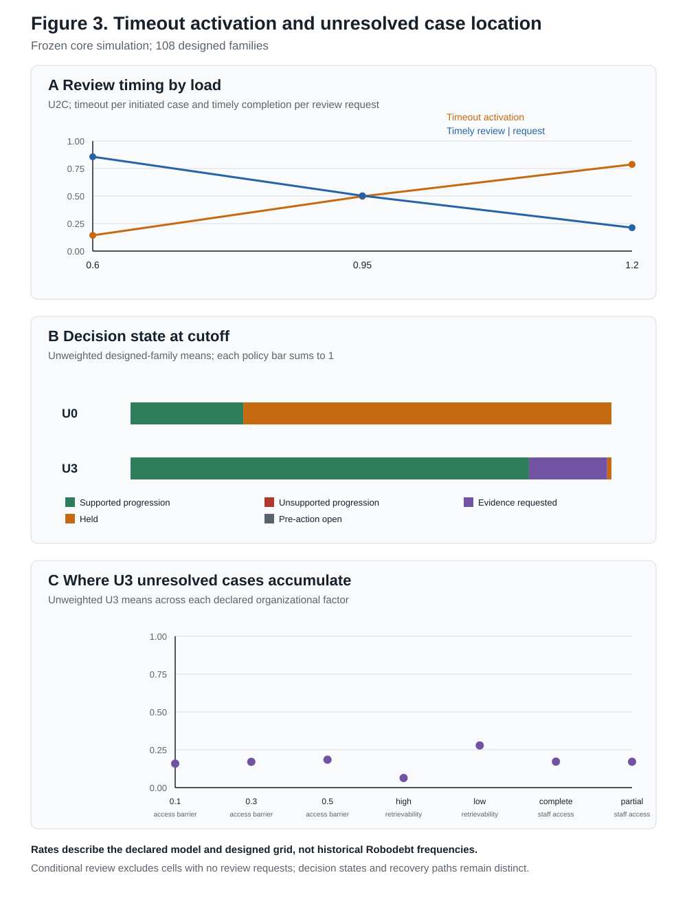

# Article Draft: Dynamic Simulation Methods and Results

Status: first publication-facing draft from the frozen core and sensitivity receipts

Working title: *From Incomplete Evidence to Automated Action: A Formal Model and Dynamic Simulation of Review Capacity and Timeout Rules, with a Robodebt Application*

The section numbers follow `ARTICLE_OUTLINE.md`. Repository identifiers are retained only where they are needed for exact reproduction. The prose treats the simulation as a computational demonstration over a designed parameter space, not as a numerical reconstruction of Robodebt or an estimate of a real-world population.

## 5. Dynamic Simulation Methods

### 5.1 Kernel and unit of analysis

We implemented a finite-cohort discrete-event simulation of an administrative evidence-to-action process. The process unit was a case; one run was an 80-case family-policy-replication cohort; policies were paired within family and replication; and the scenario family was the cross-scenario summary unit. Cases moved through engagement, evidence representation, routing, possible review, action, exposure, correction, and restoration. Shared staffed stages used finite-capacity, work-conserving FIFO queues with deterministic server ties. Open paths at the day-650 cutoff were right-censored by stage rather than classified as resolved.

The kernel was case-neutral: no Robodebt identifier or case-specific rule entered its event logic. Robodebt established structural relevance; unmeasured quantities remained stylized rather than becoming historical calibration. Policies, evaluation rules, execution counts, and scenario mappings retained separate frozen owners.

Matched policies shared case membership, latent attributes, potential evidence, access attributes, and exogenous draws. Draws were keyed by case, event family, and index, so policy-induced events could not shift unrelated draws. This common-random-number design reduced computational noise without suppressing policy-induced path differences.

### 5.2 Policy designs

We compared five counterfactual policy designs. They are study-owned interventions, not labels for historical Robodebt policies.

| Policy | Operational rule | Principal modeled tradeoff |
| --- | --- | --- |
| Claimant-led evidence and hold (U0) | Hold while required evidence is missing. | Avoids unsupported progression but may retain unresolved cases and interactions. |
| Impute and progress (U1) | Impute and permit automatic progression. | Failure benchmark for progression without action-specific support. |
| Review with fail-closed timeout (U2C) | Impute with evidence status preserved, route all potential progression to review, and hold if review does not complete in time. | Preserves the gate but can accumulate holds. |
| Review with fail-open timeout (U2O) | Impute with evidence status preserved, route all potential progression to review, and permit progression if review times out. | Converts non-completion into potentially unsupported action. |
| Agency-assisted information first (U3) | Assist engagement and retrieve evidence; progress when support is obtained and route unresolved cases to fail-closed review and holding. | Consumes resources and may add interactions, delay, or exposure. |

U2O−U2C isolated the consequence of review non-completion under otherwise shared review machinery. U3−U0 compared assisted evidence acquisition with conservative holding. U1−U0 was an implementation-validation contrast, not a substantive policy comparison.

### 5.3 Frozen scenario design and execution

Before inspecting core results, we froze policies, scenarios, seeds, outcomes, contrasts, and the precision and analysis rules. This prospective record constrained result-driven tuning and supports reproduction; it was not external preregistration or population-level inference.

The core crossed five stylized factors, none a historical Robodebt estimate.

| Factor | Levels | Executable mapping |
| --- | --- | --- |
| Nominal initiation load, L | 0.60, 0.95, 1.20 | Initiation window Ns/(2cL), with N = 80, review capacity c = 2, service scale s, and uniform arrivals; realized review demand still depended on routing. |
| Missing evidence, m | 0.10, 0.30, 0.50 | Record availability 1 − m. |
| Access barrier, b | 0.10, 0.30, 0.50 | Access 1 − b; notice 1 − b/4; comprehension 1 − b/2. |
| Retrievability | low, high | Retrieval success 0.35 or 0.85. |
| Staff access | partial, complete | Partial access multiplied the uniform review-service scale from 10 to 15 days. |

Keyed U[0,1) variates generated binary events by threshold and stochastic timings by declared scales. Recovery and reassessment used fixed service demands. Fixed policy-contrast inputs were:

| Mechanism | Fixed core inputs |
| --- | --- |
| Engagement and assistance | Notice delay 1 day; response deadline 21 days; response-effort limit 0.55; assistance capacity 2, service scale 5 days, and window 21 days; extension need 0.25 and scale 7 days. |
| Review and exposure | Review capacity 2; service U[0, s), with s = 10 or 15 days by staff access; window 14 days; exposure delay 1 day. |
| Retrieval and recovery | Retrieval latency U[0, 10) days in the core; recovery capacity 2, fixed service demand 8 days, and window 20 days. |
| Correction and restoration | Correction-uptake probability 0.50 after a 7-day delay; reassessment capacity 2, fixed service demand 10 days, and window 14 days; restoration delay 5 days, window 50 days, and administrative cutoff day 650. |

The 108-family design used five policies and 30 paired replications: 16,200 core runs and 1,296,000 case-policy trajectories. Load was a designed input, not measured utilization or an estimated threshold. The corrected frozen manifest fixed 3,240 family-replication seeds per suite under SHA-256 identity `9d0d2ed34f74608e5aed96b6a28d81ded2d6d15bba552be91706c5ce862b2801`.

MCSE targets were 0.05 for rates and 0.06 for paired differences. A miss after 30 replications would have extended every core cell to 60; none did. A separate 16,200-run sensitivity doubled retrieval-latency scale from 10 to 20 days without pooling with the core.

### 5.4 Outcomes and estimands

Unsupported progression was executed progression lacking action-specific support under the frozen evaluation rule. Its rate, unresolved holding, exposure, and right-censoring used initiated cases as denominator. Gate safety used applicable configured gates and tested whether they blocked progression while prerequisites remained unmet.

Administrative closure did not manufacture a terminal disposition. Conservative holds and supported downstream-exposure paths had no modeled terminal-resolution event, so they remained right-censored even when no queue extended to day 650. Complete restoration was observed or ruled out only on modeled correction-and-restoration paths following unsupported progression. Censoring therefore identifies an open or unmodeled terminal path, not necessarily excessive elapsed time or evidentiary failure.

The frozen `review_effective_rate` divided timely pre-action completions by queued requests. Policies supplied surfacing, stopping authority, gate dependency, action binding, and recording; the rate did not vary or score those conditions. Partial staff access lengthened service rather than creating a separate visibility failure. We therefore call it **timely review completion**: the timing component, not validation of the full formal `ReviewEffective` construct. These operational measures are not legal judgments.

The interaction-event rate counted responses plus assistance requests per case. Its frozen field, `recipient_burden_rate`, does not measure effort, subjective burden, welfare, or cost. Agency workload counted completed assistance, retrieval requests, completed reviews, and completed reassessments per case. Exposure marked entry into a downstream consequence path; it could follow supported or unsupported progression and was not itself error or harm.

We report family-specific paired differences, 95% normal MCSE intervals, family ranges, and unweighted designed-family means. MCSE measures finite-run precision, not population, historical, or model uncertainty; cross-family means assume no real-world scenario distribution.

Expectations 1–3 correspond to internal freeze labels H1–H3, not empirical-population hypotheses.

The service construct required a supported disposition by deadline, but its numerator counted every no-review case without checking disposition. We excluded all numerical service results and chose no substitute; repair requires a new version, freeze, and affected rerun.

### 5.5 Validation, controls, and claim boundary

Validation covered hand traces, queues and timeouts, replay, configuration closure, adapter substitution, conservation, five negative controls, and append-only receipts. All 32,400 expected runs reconciled, representing 2,592,000 trajectories; 178 automated checks and all controls passed. Maximum MCSE was 0.04332 core and 0.04051 sensitivity.

Execution integrity does not rehabilitate the invalid service construct. Estimates apply only to the declared model and parameter space, not historical prevalence, legality, monetary error, or omitted mechanisms.

## 6. Results

### 6.1 Execution integrity, precision, and measurement audit

All 16,200 core and 16,200 sensitivity runs reconciled with no missing or unexpected identifiers. Each suite contained 108 families, five matched policies, 30 replications, and 80 cases per run. Precision targets were met without extension; deterministic replay and all five controls passed, with no post-freeze execution change.

The semantic audit found the service-numerator mismatch described above. We exclude that measure from results, figures, and conclusions without a post hoc substitute. This is a construct-validity failure in the demonstration, not an execution failure or population finding.

Every U0, U2C, and U3 family cell had an open-or-administratively-censored terminal-path rate of 1.000; unweighted designed-family mean rates were 0.219 for U1 and 0.524 for U2O. These values combine structural non-absorption with work that exceeded day 650. The simulation therefore does not identify terminal disposition or permit complete-restoration comparisons for those policies, although earlier stage-specific outcomes remain interpretable within their horizons.

### 6.2 Expectation 1: fail-closed safety across tested load regimes

Under U2C, unweighted mean gate safety remained 1.000 at nominal loads 0.60, 0.95, and 1.20. Across the other factors, timely review completion fell from 0.857 to 0.502 to 0.212, while unresolved holding rose from 0.143 to 0.498 to 0.788.

Fail-closed review thus preserved the permission boundary by retaining cases that review did not resolve in time. Gate safety is not timely service, and holding is not harmless: it defers action while leaving recipients and administrators in an open process.

The pattern matches expectation 1 within the design, but three loads do not locate a continuous threshold. The excluded service measure also leaves its timely-supported-service component unevaluated.

### 6.3 Expectation 2: fail-open timeouts convert review shortfall into progression

The paired U2O−U2C contrast held cases, draws, and review machinery fixed while changing the consequence of non-completion. Unsupported progression increased by an unweighted mean +0.476 across families (range +0.042 to +0.881); all 108 family MCSE intervals lay above zero.

Exposure increased identically; gate safety and unresolved holding moved by the same magnitude in the opposite direction. Timely-review-completion differences were zero in every family. U2C averaged 0.476 unresolved holding and zero unsupported progression; U2O averaged the reverse. The policies differed after review non-completion, not in review completion itself.

Direction follows the declared timeout rules; the simulation supplies magnitude, scenario variation, and queue consequences. Exposure is downstream of progression, not independent confirmation. Fail closed preserves the permission boundary but retains cases; fail open replaces those holds with potentially unsupported action and exposure.

### 6.4 Expectation 3: the information-first tradeoff

Expectation 3 was not answerable as framed: U3−U0 was unconditional, the interaction proxy counted events rather than effort or welfare, and service measurement failed audit. The comparison describes process events, not substantive recipient burden.

Both policies produced zero unsupported progression in all 108 families. The prospective plan named unresolved cases, but the receipt omitted that paired U3−U0 metric. Unweighted designed-family mean unresolved-hold rates were descriptively 0.009 under U3 and 0.766 under U0: fewer action-stage holds, not a paired estimate or proven terminal resolution. U3 gate-safety and review values were outside its frozen applicable set and remain uninterpreted.

U3−U0 increased interaction events by mean +1.096 per case (range +0.860 to +1.312) and workload events by +1.209 (+0.749 to +1.728); every family interval lay above zero. The proxy moved opposite the expected direction. Because U0 generates none of the counted workload events, that direction is definitional; magnitude and variation are simulated.

Exposure also increased by an unweighted family mean +0.594 in rate units (range +0.369 to +0.815), with every interval above zero. Because both policies had zero unsupported progression, this reflects downstream movement that can follow supported action. Descriptively, U3 combined fewer action-stage holds with more interactions, work, and exposure while terminal paths remained open. Substantive burden therefore remains unresolved, not rejected.

### 6.5 Censoring, validation contrast, and sensitivity

Unweighted designed-family mean shares of initiated cases remaining before exposure or on an open exposure/recovery path were 76.6%/23.4% under U0, 88.5%/11.5% under U2C, and 17.1%/82.9% under U3. U1 censored 21.9% of initiated cases, all on the latter path; U2O censored 52.4%, split 40.9%/11.5%. These cutoff-stage classifications include structurally open paths and imply neither resolution nor complete restoration; exact codes remain in the supplement.

The U1−U0 validation contrast increased unsupported progression by mean +0.781 (range +0.578 to +0.914), with every interval above zero. It confirms benchmark activation, not a substantive discovery or recommendation.

With retrieval latency doubled, U3 and U0 again had zero unsupported progression. Unweighted designed-family mean U3−U0 sensitivity differences were +1.098 interaction events per initiated case (+0.855 to +1.325), +1.209 workload events per initiated case (+0.748 to +1.724), and +0.595 in exposure rate (+0.370 to +0.824); every family interval remained positive. This is stability to one perturbation, not general robustness.

### 6.6 Synthesis

Fail-closed review preserved the permission boundary as nominal load rose but not timely completion or resolution. With review machinery fixed, timeout semantics determined whether non-completion remained a hold or became unsupported progression and exposure. Information-first assistance also produced zero unsupported progression and descriptively left fewer action-stage holds than conservative holding, but added interactions, workload, and exposure; terminal resolution and substantive burden remain unmeasured.

The strongest result is that identical timely-review-completion rates can coexist with opposite permission consequences. Meaningful control therefore depends on evidence, capacity, deadlines, and defaults—not a nominal reviewer. Timely supported service was invalidly measured, substantive burden received only an interaction proxy, and censoring blocked complete-restoration comparisons.

**Figure 3. Capacity, timeout, and information-first tradeoffs.** Panel A shows the fail-closed load response. Panels B and C show unweighted means and family ranges for the paired policy contrasts. Family ranges describe variation across the 108 designed scenarios, not uncertainty; Panel C labels its different outcome units explicitly.

**Table 3. Prespecified paired estimates, computational precision, and claim boundaries.**

| Contrast | Outcome | Mean difference | Family range | MCSE range; intervals excluding zero | Claim key |
| --- | --- | ---: | ---: | ---: | :---: |
| U2O − U2C | Unsupported-progression rate | +0.476 | +0.042 to +0.881 | 0.009–0.043; 108/108 above | A |
| U2O − U2C | Gate-safety rate | −0.476 | −0.881 to −0.042 | 0.009–0.043; 108/108 below | A |
| U2O − U2C | Timely-review-completion rate | 0.000 | 0.000 to 0.000 | 0.000; 0/108 | A |
| U2O − U2C | Unresolved-hold rate | −0.476 | −0.881 to −0.042 | 0.009–0.043; 108/108 below | A |
| U2O − U2C | External/recovery-process-exposure rate | +0.476 | +0.042 to +0.881 | 0.009–0.043; 108/108 above | B |
| U3 − U0 | Unsupported-progression rate | 0.000 | 0.000 to 0.000 | 0.000; 0/108 | C |
| U3 − U0 | Recipient interaction events per case | +1.096 | +0.860 to +1.312 | 0.012–0.024; 108/108 above | C |
| U3 − U0 | Agency-workload events per case | +1.209 | +0.749 to +1.728 | 0.011–0.027; 108/108 above | C |
| U3 − U0 | External/recovery-process-exposure rate | +0.594 | +0.369 to +0.815 | 0.006–0.013; 108/108 above | B, C |
| U1 − U0 | Unsupported-progression rate | +0.781 | +0.578 to +0.914 | 0.004–0.011; 108/108 above | D |

Claim boundaries: **A**, timeout directions follow the declared fail-open/fail-closed semantics; the simulation supplies magnitude and family variation. The policies used the same review queue, and fewer holds represent progression rather than established resolution. A fail-open release with unmet prerequisites is not gate-safe. **B**, exposure is structurally downstream, may follow supported progression, and is neither independent confirmation nor proof of harm. **C**, both policies prevented unsupported progression; interaction events do not measure effort, subjective burden, welfare, or cost, while the workload direction follows the metric and policy definitions. **D**, U1−U0 is implementation validation, not a substantive discovery or recommendation.

*Note:* Differences are left policy minus right policy. Means and ranges are unweighted summaries over 108 deliberately designed scenario families. Each family estimate uses 30 paired replications. A family-specific computational-precision interval is the paired estimate ± 1.96 × MCSE; these intervals do not represent population, historical, or model uncertainty. The semantically invalid timely-supported-decision-service output is excluded. U3−U0 unresolved holding is not included because the frozen receipt did not generate that paired estimand.

## Draft Traceability Notes (Not Article Prose)

| Draft claim | Frozen artifact |
| --- | --- |
| Core execution, precision, family summaries, and paired estimates | `outputs/confirmatory_v1/analysis/analysis_r030.json` (`analysis_hash`: `4d549f5e1fed84f294052749d9987d807e9fe2199843b44d7eb7aece867b36bd`) |
| Latency sensitivity estimates | `outputs/sensitivity_information_latency_v1/analysis/analysis_r030.json` (`analysis_hash`: `f1cbc3437418e803510483a080052444ce75658df42a95fcd5f4f6922f637452`) |
| Complete run inventories | `outputs/confirmatory_v1/reconciliation.json`; `outputs/sensitivity_information_latency_v1/reconciliation.json` |
| Policy, factor, seed, horizon, and precision definitions | `experiments/configs/confirmatory_v1.yaml`; `experiments/configs/sensitivity_information_latency_v1.yaml` |
| Negative-control results | `data/golden_traces/slice4_negative_control_receipt_v1.json` |
| Design-freeze identity | corrected manifest hash `9d0d2ed34f74608e5aed96b6a28d81ded2d6d15bba552be91706c5ce862b2801` |
| Figure 3 deterministic build | `reporting/build_article_figure3.py`; source receipt is the frozen core analysis above |
| Excluded service numerator | `src/uncertainty_permission_simulation/experiments.py`, function `_run_metrics` |
| Stage-specific censoring semantics | `src/uncertainty_permission_simulation/simulator.py`, administrative-cutoff closure logic |
