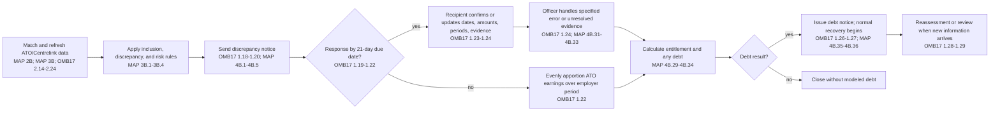
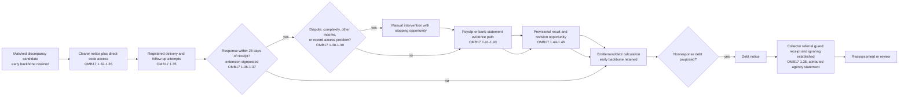

# Robodebt Case Study and Formal Crosswalk

Status: Slice 0 source-grounded application candidate; no simulation results

Profile records:

- `data/sources/robodebt/r_oci_early.yaml`
- `data/sources/robodebt/r_oci_enhanced.yaml`
- `data/sources/robodebt/source_manifest.yaml`

## Purpose and Claim Boundary

Robodebt supplies a documented administrative workflow in which aggregate evidence, evidentiary transformation, notice and access, automated routing, staff intervention, debt action, recovery, and reassessment can be represented as an evidence-to-action process. The study uses that structure to instantiate and stress-test a formal model. It does not numerically reconstruct the historical program, independently determine whether a debt was lawful, or establish that an actor strategically exploited the process.

The case supports a structural question:

> When period-specific evidence is unavailable, how do representation, routing, deadlines, access barriers, review capacity, and recovery design change what the workflow may do automatically and whether later correction repairs the resulting consequences?

The historical record supplies process structure and attributed findings. Study-authored queue, engagement, evidence-retrieval, and service parameters remain stylized unless the source manifest explicitly upgrades them.

## Source Hierarchy

Historical and legal claims follow this order:

1. The Royal Commission report owns Commission findings and recommendations.
2. The Commonwealth Ombudsman reports own their findings, process descriptions, and attributed agency statements.
3. The Royal Commission's Deloitte maps supply node-level process structure, with the publication-page caveat that they were prepared by Deloitte.
4. Services Australia supplies current agency descriptions and governance context.
5. Study inference may join documented anchors but must be labeled `inferred`.
6. Simulation assumptions are labeled `stylized` and are never converted into historical estimates by repetition or model fit.

The 2023 Ombudsman report on income apportionment is a terminology boundary only. It expressly distinguishes income apportionment from the income averaging at the heart of Robodebt; the two are not interchangeable in this study.

## Frozen Historical Profiles

### R-OCI-Early

`R-OCI-Early@1` represents the early OCI baseline from the July 2016 launch through 19 January 2017. The source packet gives month-level, not day-level, precision for the launch. The end date is the day before the first specifically dated letter change on 20 January 2017. This date rule avoids blending the initial process with the repair bundle.

The profile contains:

- matched ATO PAYG and Centrelink information, refreshed and filtered through inclusion and risk rules;
- a discrepancy notice using the selected digital or last-known-address channel;
- 21 days from the date of the letter to respond, with a reminder after 14 days;
- recipient confirmation or correction of employer, amount, and pay-period information;
- compliance-officer handling of specified errors or unresolved evidence;
- even apportionment of ATO earnings across the employer-reported period after nonresponse;
- automated entitlement calculation and debt notice where the calculation produces a debt;
- commencement of normal recovery; and
- later reassessment or internal review when new information is supplied.

### R-OCI-Enhanced

`R-OCI-Enhanced@1` is an as-documented early-2017 repair bundle, referenced to the Ombudsman's 10 April 2017 report. It is not assigned a fictitious single activation date. The source identifies a first letter change on 20 January, further changes from February, and agency information supplied on several February dates.

The repair profile retains the early matching and calculation backbone while adding or changing:

- direct access using a confirmation code and CRN rather than requiring myGov;
- clearer contact information and explanation that the initiation letter is not itself a debt notice;
- registered-mail and phone follow-up plus use of more recent address information where authorized;
- 28 days from receipt of the initial letter and a signposted extension route;
- manual routing for disputed inputs, more complex circumstances, selected other-income answers, and lack of access to records;
- a bank-statement route that visibly produces an estimated gross amount;
- more opportunity to revise inputs before accepting a provisional result; and
- a stated guard against debt-collector referral after nonresponse until the agency was satisfied the notice was received and ignored.

The profile is not EIC, CUPI, PAYG Manual, or the later remediation program. Those require separate dated records.

## Source-Anchored Process Maps

### Early OCI baseline

### Early-2017 repair bundle

These diagrams show documented structural paths, not transition probabilities, queue disciplines, or causal effect sizes. “Manual intervention” denotes a configured route; it does not by itself establish `ReviewEffective` or `DecisionServiceEffective`.

## Early-to-Enhanced Change Crosswalk

| Process issue | Early profile | Enhanced profile | Source anchor | Formal relevance |
| --- | --- | --- | --- | --- |
| Login/access | MyGov setup could be required | Confirmation code and CRN permit direct access | OMB17 1.19, 1.32 | Administrative access and notice-to-response transition |
| Contact route | Initial letter lacked a phone number until 20 January 2017 | Compliance number and clearer help | OMB17 1.19, 1.33–1.34 | Information action and access barrier |
| Delivery | Digital channel or last-known address | Registered mail, later phone attempt, updated address sources where authorized | OMB17 1.18, 1.35 | Notice delivery and engagement precondition |
| Response clock | 21 days from letter date | 28 days from receipt; extension signposted | OMB17 1.19, 1.36–1.37 | Deadline semantics and service window |
| Complex/disputed cases | Error/manual paths existed but were narrower | More explicit manual-intervention triggers | OMB17 1.24, 1.38–1.39 | Routing, review evidence, and stopping opportunity |
| Evidence access | Customer supplied detailed information and documents | Bank-statement route when payslips unavailable | OMB17 1.23–1.24, 1.41–1.43 | Information acquisition and burden transfer |
| Provisional result | Re-entry and later reassessment available | More pre-acceptance revision and clearer provisional warning | OMB17 1.28, 1.44–1.46 | Surfacing, contestability, and timing |
| Collection referral | Normal recovery after debt notice | Nonresponse referral guard tied to notice receipt and ignoring | OMB17 1.22, 1.35 | Gate safety for recovery action |

The crosswalk establishes that a repaired workflow may improve access, surfacing, evidence acquisition, and some routing without guaranteeing adequate capacity or timely review. That distinction motivates the dynamic simulation.

## Formal-Model Crosswalk

| Formal construct | Robodebt application | Provenance | Source or study owner |
| --- | --- | --- | --- |
| `e_less` | Annual employer-income total and broad employment period | documented abstraction | OMB17; source profile |
| `e_more` | Fortnight-specific income and working dates supported by payslips, bank records, employer records, or equivalent evidence | documented abstraction | OMB17; source profile |
| `rho(e_less)` | Evenly apportioned fortnightly values derived from aggregate income | documented | OMB17 1.22 |
| Formal authority `L(q)` | Authority or constraint established by an authoritative legal source | source-attributed only | Royal Commission or other legal authority |
| Automatic functional permission `P_auto` | Workflow permits automatic calculation, debt notice, recovery step, hold, or information action | documented or counterfactual policy | profile or policy record |
| Operational action `X` | Action actually appearing in the simulated trace | simulated | event engine |
| Surfacing | Notice, interface, reviewer record, or decision record exposes evidence type, assumption, dispute, and consequence | mixed | profile plus simulation record |
| Effective review | Authorized reviewer sees relevant evidence and can change the exact action before foreclosure | formal test; not assumed from a route | evaluation specification |
| Decision service | Supported disposition reached within a declared service window | stylized evaluation rule unless directly sourced | preregistration/evaluation specification |
| Restoration | Debt reduction or zeroing plus separate repair of recovery and other modeled consequences | mixed | source profile plus simulation metric |

The source profile never supplies its own support oracle. Independent `sigma` records define the evidentiary rule, baseline, materiality, required meaning, review conditions, and restoration obligation used in formal assessment.

## Three-Axis Claim Table

| Claim type | Question | Historical owner | Simulation output? | Permitted article language |
| --- | --- | --- | --- | --- |
| Evidentiary support | Did the declared period-specific support rule hold at action time? | Independent evaluation specification, source-labeled | yes | “Supported/unsupported under the declared rule.” |
| Numerical correctness | Did the simulated amount match the stylized full-information oracle? | Study oracle | yes | “Matched/differed from the stylized oracle.” |
| Legal validity | What did authoritative sources establish about the historical process and law? | Royal Commission, court, tribunal, Ombudsman, or other authority | no | “The source found/stated…” with citation. |

No single “valid/invalid” field may collapse these axes. A simulated amount may match the oracle while lacking the declared evidentiary support; numerical error does not itself establish illegality.

## Parameter Provenance and Simulation Boundary

| Parameter or rule | Historical status | Simulation treatment |
| --- | --- | --- |
| Early initial response clock | Documented: 21 days from letter date | Historical fixture value and core reference environment |
| Enhanced initial response clock | Documented: 28 days from receipt | Enhanced fixture value; never varied alone when interpreting the historical repair bundle |
| Early 14-day reminder | Documented | Historical fixture event |
| Enhanced provisional 14-day warning | Documented as a separate post-provisional period | Separate deadline type; must not replace the 28-day initial clock |
| Queue capacity and staffing | Not established for numeric reconstruction | Stylized factor/sensitivity parameter |
| Service-time distributions | Not established | Stylized and validated through limiting cases |
| Notice delivery and engagement probabilities | Not established as model-ready distributions | Stylized paired draws |
| Evidence availability/retrieval probabilities | Not established as model-ready distributions | Stylized paired draws |
| Recipient burden units | Not historically measured by this packet | Transparent study index or event counts; no field estimate claim |
| Full-information amount oracle | Study-authored | Numerical validation tool, not legal decision rule |

## Limitations and Unsupported Elements

- The source packet does not provide a complete executable specification of every production business rule or every period-specific system version.
- The early and enhanced profiles are bounded reference fixtures, not exhaustive histories.
- The enhanced profile combines changes documented as in place by the April report; activation dates vary and are not all known.
- The Deloitte maps contain cross-period annotations. A node marked as changed cannot be assigned to both profiles without a separate anchor.
- A configured officer path does not establish reviewer capacity, timely completion, evidence quality, or stopping effectiveness.
- Reassessment availability does not establish awareness, access, uptake, timeliness, or complete restoration.
- Later EIC, CUPI, PAYG Manual, class-action remediation, and current Services Australia processes are outside these two profiles.
- The case does not establish adversarial inducibility, observability, repeatability, benefit, or historical exploitation.
- Current automation and AI strategy is governance context only and is not evidence of mechanism recurrence.

## Implementation Contract

Robodebt is implemented as immutable source fixtures plus a thin application mapping over the case-neutral process and policy contracts. The deterministic compiler separates a process capability graph from historical policy behavior and combines them with an independent evaluation specification and separately owned scenario overlay. It may bind sourced terminology, dated transitions, roles, and documented values; it may not execute raw descriptions or guard strings, or own event-loop, queue, random-stream, formal-evaluation, or generic policy semantics.

Before a historical fixture can execute:

1. every transition must reference a profile transition ID and source claim;
2. every parameter must carry `documented`, `attributed_agency_statement`, `inferred`, `stylized`, or `unsupported` provenance;
3. unsupported historical parameters must fail validation rather than receive silent defaults;
4. any executable study value absent from the historical record must come from a separately versioned stylized scenario overlay;
5. counterfactual U-policy behavior must use a different policy record from either historical profile;
6. legal status must remain a source-attributed field outside the simulator's calculation logic;
7. output reports must state that the profiles support structural relevance, not numeric reconstruction;
8. an isomorphic synthetic adapter must be able to exercise the same semantic path without changing core code;
9. every runtime parameter must have one `ParameterBindingReceipt`, documented values cannot be overwritten, and compilation must leave zero unresolved slots; and
10. the enhanced profile must retain its mixed-precision `as_documented_bundle` temporal scope without a fictitious common activation date.

Slice 1 first implements the schemas and deterministic configuration compiler, then the canonical synthetic vertical traces and generalizability canaries, and only then the minimal early-profile adapter trace required by its stage gate. Slice 2 owns the complete early/enhanced executable adapters, stylized overlays, and stochastic dynamics. The Robodebt mapping may be narrowed or versioned until the confirmatory freeze, with every change logged and the owning automated gates rerun. If the post-simulation project-lead review exposes a semantic defect, the affected freeze and confirmatory artifacts must be invalidated and rerun.
